<p align="center">
  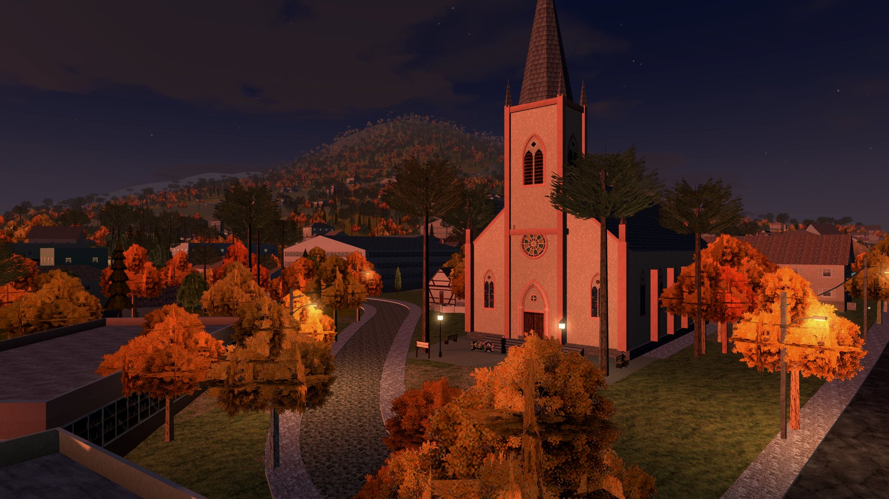
</p>

<h1 align="center">Teewald</h1>

<p align="center">
  <b>Terror em terceira pessoa com cara de PlayStation 1, numa Santa Maria do Herval (RS) montada com dados reais.</b><br>
  Roda no navegador: computador, celular e controle.
</p>

<p align="center">
  <a href="https://fabianokunst.github.io/Teewald-3d/"><b>▶ JOGAR NO NAVEGADOR</b></a> ·
  <a href="https://fabianokunst.github.io/Teewald-3d/site/">Site do jogo</a> ·
  <a href="#como-rodar">Como rodar</a> ·
  <a href="#arquitetura">Arquitetura</a>
</p>

<p align="center">
  <a href="https://github.com/fabianokunst/Teewald-3d/actions/workflows/deploy.yml"></a>
  
  
  
  
  
  
  
</p>

Jogo de terror em terceira pessoa com visual de PlayStation 1, ambientado numa
versão de Santa Maria do Herval (RS) em maio de 1997, no outono: neblina, céu encoberto e uma
cidade com medo do que anda no mato. São doze capítulos: o chupacabras, os cães de
fogo, a moça da fábrica, os ETs de Varginha, a Fera da madrugada, os telefones que
chamam para o mato, o lobisomem, o cemitério na Noite das Almas, a mulher da fotografia, os
morcegos-vampiro e a bruxa Otília, com luta corpo a corpo,
armas especiais, noite, chuva, tempestade, neblina e lua cheia. O protagonista chega
à cidade no carro dele, um sedã preto de quatro portas do fim dos anos 60, que dá para
dirigir a qualquer hora. Roda no navegador (Three.js + Vite).

<table>
  <tr>
    <td width="33%">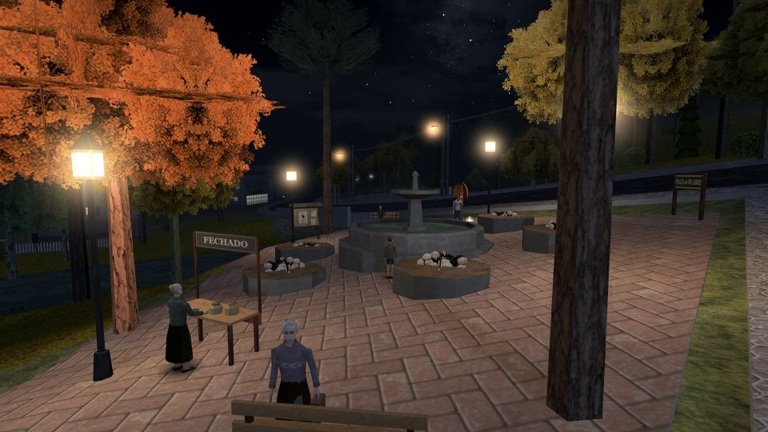<br><sub>Praça 10 de Abril: cada lampião é uma luz dinâmica calculada por pixel</sub></td>
    <td width="33%">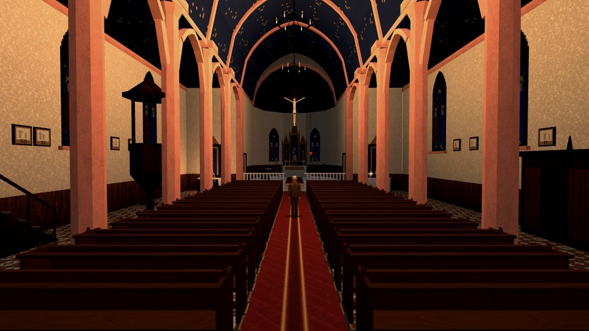<br><sub>Igreja Matriz por dentro, montada longe da cidade e com colisão própria</sub></td>
    <td width="33%">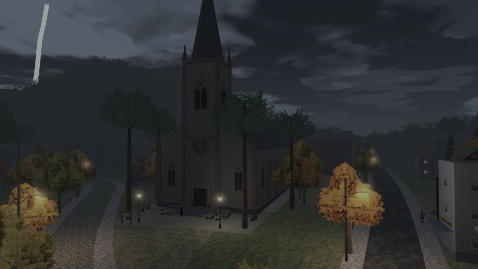<br><sub>Tempestade: raio em três pulsos, trovão atrasado pela distância</sub></td>
  </tr>
  <tr>
    <td>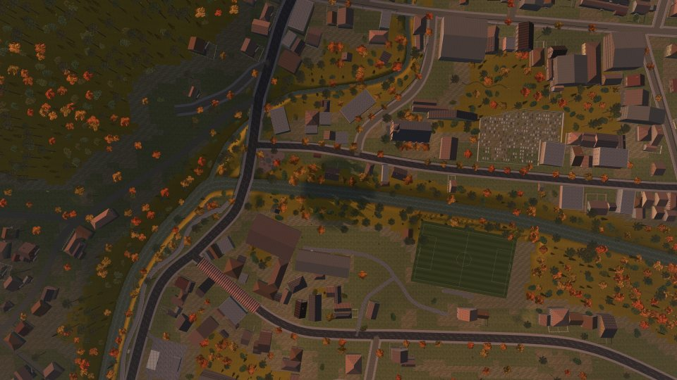<br><sub>Vista de cima: ruas do OpenStreetMap, relevo SRTM e contornos de prédios de satélite</sub></td>
    <td><br><sub>Estilo PS1 RETRÔ: 240 linhas, dithering 4×4 e cor de 15 bits</sub></td>
    <td>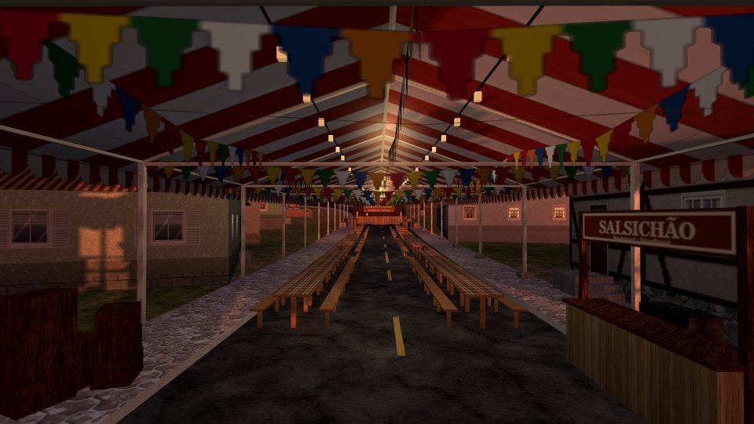<br><sub>Pavilhão da Kartoffelfest montado sobre a Rua Beno Closs</sub></td>
  </tr>
</table>

## Destaques técnicos

- **Cidade a partir de dados reais.** Ruas e rios do OpenStreetMap, relevo do SRTM e contornos
  de prédios da Microsoft viram 594 construções, 16.343 árvores e cerca de 1 milhão de triângulos,
  gerados toda vez que o jogo abre.
- **Nenhum modelo 3D nem arquivo de som.** Personagens, criaturas, prédios, carros e itens são
  montados em código, as animações são procedurais (IK) e todos os sons são sintetizados com
  Web Audio. Os únicos arquivos de mídia são fotos de material (madeira, pedra, telha...).
- **Shader PS1 próprio**, com sombreamento Gouraud, 8 luzes dinâmicas por pixel, sombra com cache
  da parte fixa da cidade, 14 climas com transição suave e dois estilos (3D limpo e PS1 retrô).
- **Um robô joga a campanha inteira** num Chrome sem janela, testa o salvamento em cada etapa e a
  morte em cada capítulo. Outros scripts auditam o mapa, medem o volume de cada som em LUFS e
  tiram as fotos do site.
- **Quatro idiomas** sem mexer no código do jogo: o texto é traduzido na hora de desenhar.
- **Carro dirigível** com física própria (derrapagem, ladeiras, suspensão, batidas com giro),
  moradores que pulam para fora do caminho, criaturas atropeladas e animação de entrar e sair.
- **Teclado e mouse, controle e toque**, com mira assistida, vibração e menus próprios para o celular.

## Em números

| | |
|---|---|
| Código do jogo | ~43.500 linhas de JavaScript em 101 módulos (`src/`) |
| Ferramentas e testes | ~1.600 linhas em `tools/` (Node + puppeteer-core) |
| Dependências | 1 em execução (`three`); 2 de desenvolvimento (`vite`, `puppeteer-core`) |
| Build | `index.js` 1,79 MB (589 kB gzip); cada dicionário (en, es, de) ~50 kB gzip, carregado só quando escolhido |
| Área do mapa | dados de ~4 × 4 km; relevo até ±3,4 km do centro; área jogável de ~3 × 3 km (a cidade e 1 km de interior para cada lado) |
| Construções | 1.488 (1.328 contornos de satélite, divididos em 1.614 retângulos), entre elas 158 galpões e 9 aviários no interior |
| Árvores | 69.202 instâncias de 10 modelos |
| Interior | represa de 1,5 ha com barragem e usina, ~23 km de cerca de arame (5.820 palanques), ~66 mil pedaços de fileira de milho seco, 422 fardos |
| Triângulos na cena | 4.235.233 (contando as instâncias e as versões simples das árvores de longe) |
| Colisores | 55.892, numa grade espacial de 8 m |
| Por quadro, no início do jogo | 1.744 chamadas de desenho e ~977 mil triângulos, a 60 fps¹ |
| Carregamento | ~6 s até o mundo pronto¹ |
| Protagonista | 1.201 triângulos, 18 ossos, textura pintada no carregamento |
| Moradores | 24, no mesmo esqueleto do protagonista, com 27 gestos |
| Criaturas | 8 espécies (chupacabras, cão de fogo, morcego, fantasma, ET, Fera, lobisomem, bruxa) e 9 chefes |
| Sons | ~120 funções de síntese; 105 deles medidos pelo `npm run sons` |
| Carro do protagonista | ~3.000 triângulos (porta, volante e rodas soltos), 12 sons sintetizados |
| Texto | 1.601 textos em cada dicionário (en, es, de) |
| Arquivos do jogo | 20 documentos, 11 fichas de lenda, 9 ligações de orelhão |

¹ Build de produção, Chrome 155 sem janela, NVIDIA T1000, 1600×900, estilo 3D limpo e iluminação avançada.

## Sumário

- [Como rodar](#como-rodar)
- [Arquitetura](#arquitetura)
- [Renderização](#renderização)
- [Mundo: de dados reais a cidade 3D](#mundo-de-dados-reais-a-cidade-3d)
- [Física, colisão e chão](#física-colisão-e-chão)
- [Personagens e animação](#personagens-e-animação)
- [Combate, armas e criaturas](#combate-armas-e-criaturas)
- [O carro](#o-carro)
- [Campanha, salvamento e dificuldade](#campanha-salvamento-e-dificuldade)
- [Som](#som)
- [Idiomas](#idiomas)
- [Controles e entrada](#controles-e-entrada)
- [Ferramentas e testes](#ferramentas-e-testes)
- [Build, publicação e sincronização](#build-publicação-e-sincronização)
- [Depuração](#depuração)
- [O jogo](#o-jogo)
- [Site do jogo](#site-do-jogo)
- [Estrutura](#estrutura)

## Como rodar

Precisa do Node.js (22.12 ou mais novo: o Vite 8 pede 20.19, e as ferramentas com
puppeteer-core pedem 22.12) e de um navegador com WebGL 2. As ferramentas de teste e
captura usam o Chrome ou o Edge instalado no computador.

- Dê dois cliques em `iniciar.bat` (instala as dependências se faltarem e abre o jogo), **ou**
- no terminal: `npm install` (só na primeira vez) e depois `npm run dev`.

O navegador abre em `http://localhost:5173`.

| Comando | O que faz |
|---|---|
| `npm run dev` | servidor do Vite com recarga automática, porta 5173 |
| `npm run build` | build de produção em `dist/` (o site vai junto, em `dist/site/`) |
| `npm run preview` | serve o `dist/` como no GitHub Pages |
| `npm run teste` | um robô joga a campanha inteira e confere salvamento e morte ([detalhes](#teste-da-campanha-npm-run-teste)) |
| `npm run audit` | revisão técnica do mundo, com o `npm run dev` rodando ([detalhes](#auditoria-do-mundo-npm-run-audit)) |
| `npm run sons` | mede o volume de cada som em LUFS ([detalhes](#medidor-de-som-npm-run-sons)) |
| `npm run traduzir` | acha textos novos no código e atualiza os dicionários |
| `npm run mapdata` | regera `src/world/mapdata.json` (`-- --refresh` baixa tudo de novo) |
| `npm run exportar` | grava o protagonista em `exportados/teewald-protagonista.glb` |
| `npm run texturas` | grava o atlas de textura do protagonista em `texture-templates/forasteiro/` (`-- arno hilda` para moradores) |
| `npm run shot` | uma captura do jogo (`node tools/screenshot.mjs saida.png "?skip=1"`) |
| `npm run capturas` | refaz as fotos do site |
| `npm run social` | refaz as peças do Instagram em `social/`: fotos, posts, stories e o reels ([detalhes](#capturas-retratos-e-exportação)) |
| `npm run retratos` | refaz a lista completa de `personagens/` (criaturas incluídas) e as fichas de `site/personagens.html` |
| `npm run site` | refaz a cabeça, o topo e o rodapé das páginas do site, as páginas em inglês, espanhol e alemão, o SEO, o sitemap e as versões para LLMs |
| `npm run documentos` | recorta os papéis do site das imagens dos documentos do jogo, nos quatro idiomas |

## Arquitetura

### Pilha

| Camada | O que usa |
|---|---|
| Linguagem | JavaScript puro em módulos ES (`"type": "module"`), sem TypeScript e sem framework |
| 3D | Three.js 0.186 sobre WebGL 2, como base de cena, geometria e câmera; os materiais do jogo são shaders próprios (`ShaderMaterial`) |
| Build | Vite 8 (Rolldown), `base: './'`, a pasta `texture/` servida como pasta pública |
| Som | Web Audio API: osciladores, ruído, filtros, atraso e compressor, sem nenhum arquivo de áudio |
| Texto e interface | um canvas 2D por cima do canvas WebGL, na mesma resolução interna |
| Entrada | teclado, mouse com Pointer Lock, Gamepad API, toque, Vibration API e Screen Wake Lock |
| Salvamento | `localStorage`: `teewald.save.v1`, `teewald.extras.v1` e `teewald.settings.v1` |
| Ferramentas | Node, puppeteer-core 25 com o Chrome do sistema, `OfflineAudioContext`, o analisador de JS do Rolldown |
| Publicação | GitHub Actions → GitHub Pages, a cada push na `main` |

### Como as partes se ligam

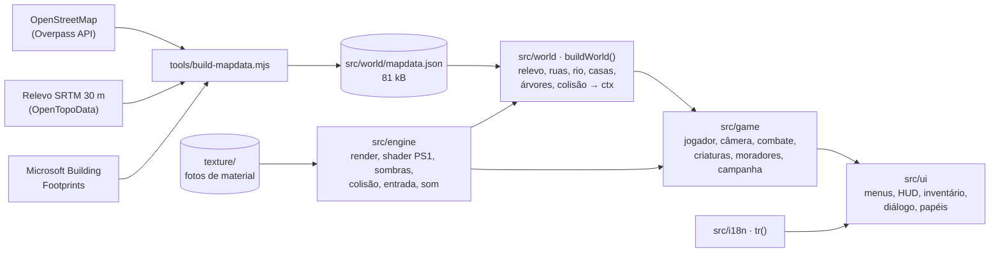

### Inicialização (`src/main.js`)

1. Idioma (`?lang=`, depois o salvo, depois o do navegador) e fontes do Google (espera no máximo 2,5 s).
2. `loadTextures`: as fotos de `texture/` são reduzidas e processadas (barra de 0 a 25%).
3. `makeMaterials` e o clima inicial.
4. `buildWorld` (`src/world/world.js`), em etapas que esperam um quadro cada para a barra andar:
   relevo → ruas e rio → igreja, praça e calçadão → casas → postes e fios → malhas 3D → árvores → céu.
5. Os sistemas são criados em ordem, cada um recebendo os que usa (injeção de dependência):
   personagem → jogador → câmera → efeitos → clima → inventário (16) → alvos → combate →
   interiores → armas → tela de inventário → moradores → corujas → missão 1 → campanha →
   extras → menus. Os quatro interiores são montados já aqui, longe da cidade.
6. Os ícones do inventário são renderizados do próprio modelo de cada item (48×48).
7. Começa o laço com `requestAnimationFrame`. Um erro na carga aparece desenhado na tela.

### O quadro

O passo de tempo é variável (`dt` limitado a 0,1 s). A opção QUADROS POR SEGUNDO limita a 30,
e no celular o limite é 60 (telas de 90/120 Hz). Para nada atravessar parede em quadros longos,
o jogador anda em pedaços de 0,12 m; no "hit-stop" dos golpes, as criaturas andam a 12% do tempo.

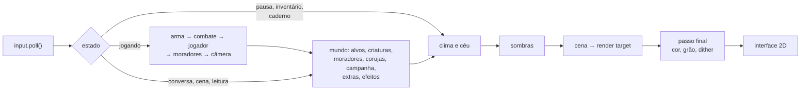

Estados: `loading`, `title`, `intro`, `play`, `talk`, `read`, `extra`, `journal`, `cutscene`,
`dying`, `inventory`, `pause`, `ending` (e `debug`, da câmera livre).

- **`ctx`** é o mundo, criado por `buildWorld`: relevo, ruas, rios, colisão, prédios, árvores,
  pisos (`floors`, `walkways`), luzes, poleiros das corujas, limites da área jogável e as
  funções `groundAt`, `surfaceAt`, `waterLevel`, `waterDepth`, `isDeepWater`, `placeName` e
  `streetName`.
- **`G`** tem dois sentidos: em `main.js` é o bloco de uniforms compartilhado por todos os
  shaders (`src/engine/ps1material.js`); nos capítulos é a instância da `Campaign`.

## Renderização

### Dois estilos, um caminho

A cena é desenhada num render target na resolução interna e depois passa por um único shader
de tela cheia (um triângulo) que escreve no canvas. A interface fica num canvas 2D por cima.

| | 3D LIMPO (padrão) | PS1 RETRÔ |
|---|---|---|
| Linhas | as da tela (até 1440) | 240 (opções: 240, 360, 480, 720, 1080 ou nativa) |
| Largura | acompanha a proporção da tela (sempre par) | idem: 320×240 em 4:3, ~426×240 em 16:9 |
| Antisserrilhado | MSAA 4× no render target; folhagem com `alphaToCoverage` | nenhum; ampliação `pixelated` |
| Texturas | o dobro da resolução PS1, filtro linear, mipmaps, anisotropia até 8× | 32 a 128 px, filtro *nearest*, cor de 15 bits |
| Dithering | não | Bayer 4×4 e quantização para 31 níveis por canal (opção) |
| Distorção de textura | não | afim, 0, 45% ou 100% (opção) |

O tremor de vértices (a malha "se mexendo") foi removido do jogo. O renderer usa
`antialias: false`, `pixelRatio` 1 (a densidade da tela entra na conta da resolução),
saída em sRGB linear e nenhum *tone mapping*: o jogo trabalha "em espaço de cor de tela",
como o PS1. Câmera: `PerspectiveCamera(58°, …, 0,25 m, 2600 m)`.

Passo final (`src/engine/renderer.js`), na ordem:

1. tira saturação (`uSat`, 0,6 a 0,85 conforme o clima) e puxa a cor para um verde frio;
2. **night lift** (`uNightLift`): levanta os pretos de noite para não virar breu;
3. contraste;
4. vinheta (bordas escuras);
5. grão de filme que muda 24 vezes por segundo;
6. *fade* (tela preta);
7. no PS1, dithering 4×4 e cor de 15 bits;
8. faixas pretas de cinema nas conversas e cenas.

<table>
  <tr>
    <td width="50%">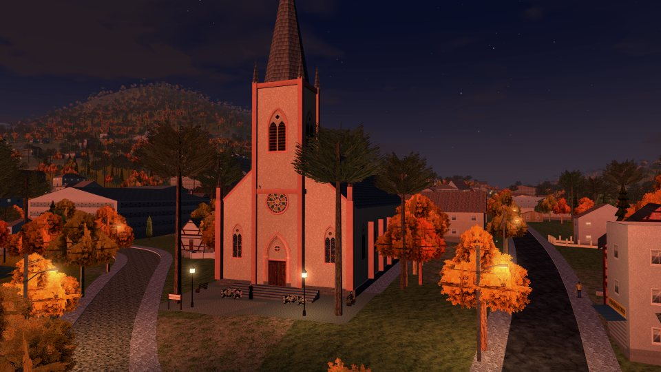<br><sub>3D LIMPO: resolução da tela, MSAA 4×, texturas suaves</sub></td>
    <td width="50%"><br><sub>PS1 RETRÔ: 240 linhas, dithering e cor de 15 bits</sub></td>
  </tr>
</table>

### O material PS1 (`src/engine/ps1material.js`)

Um `ShaderMaterial` próprio (não um remendo dos materiais do three), com os trechos de
*skinning* e instanciamento do three:

- **Sol e ambiente por vértice** (Gouraud): luz do sol com *wrap* e ambiente de hemisfério
  (céu × chão). O termo do sol fica separado para a sombra escurecer só ele.
- **8 luzes dinâmicas por pixel** (`uLights[8]`: posição e alcance; `uLightCols[8]`), com queda
  `(1 − d/alcance)²`. A luz 0 pode ser um foco: é a lanterna do protagonista, que segue a mira.
  A cada quadro `src/world/atmosphere.js` escolhe as 8: a lanterna sempre na 0, os 4 postes e
  lampiões mais perto de um ponto 8 m à frente da câmera (o último some devagar) e os pedidos
  do jogo (tiros, fogo dos cães, velas, cristais, explosões) por prioridade e distância.
- **Neblina linear por vértice**, mais quente olhando para o sol, e as bordas do relevo
  distante sumindo entre 1.360 e 1.590 m.
- **Cor por vértice** multiplicada pela cor da instância: é por ela que entram a oclusão assada
  (pés das paredes 15 a 22% mais escuros, oclusão por cápsulas no personagem) e a margem molhada
  dos rios (até 42% mais escura).
- **Mapa de brilho** (janelas acesas à noite), somado depois da neblina.
- Textura afim opcional, folhagem com *alpha test* (0,32 no limpo, 0,5 no PS1) e balanço,
  água com correnteza e ondulação.

### Sombras (`src/engine/shadows.js`)

- Uma luz direcional (o sol ou a lua), câmera ortográfica, **um mapa só** (sem cascatas):
  **2048 px cobrindo 50 m** em volta do jogador no computador, **1024 px e 40 m** no celular.
- **Cache da parte fixa.** Prédios, árvores e postes vão para um mapa estático, refeito só quando
  o jogador anda 15% do raio (7,5 m), sobe 8 m ou o sol gira. A cada quadro esse mapa é copiado
  (escrevendo `gl_FragDepth`) e só o que se mexe é desenhado por cima.
- Comparação em hardware com 4 amostras (PCF), deslocamento pela normal de 1,5 texel, centro
  preso à grade de texels (a sombra não "nada" quando a câmera anda) e sumindo entre 60 e 80%
  do raio.
- Força por clima (0,85 de tarde, 0,55 de noite, 0,8 na lua cheia...); chuva, neblina fechada e
  interiores ficam sem sombra. Na troca do sol pela lua a sombra some e volta, em vez de girar.

### Céu e clima (`src/world/atmosphere.js`, `src/world/sky.js`)

- **14 climas**: ensolarado, tarde, anoitecer, noite, lua cheia, madrugada, chuva, tempestade,
  garoa, lua de sangue, amanhecer, interior, igreja e igreja de dia. A troca leva 4 s com
  *smoothstep*, interpolando cada número e cor.
- **Céu**: domo de 1.800 m que segue a câmera. Na iluminação avançada é um shader por pixel com
  brilho em volta do sol, disco do sol, duas camadas de nuvem andando e a Via Láctea; na clássica,
  um gradiente com a textura de nuvens.
- **Estrelas**: 1.700 pelo céu e 1.600 ao longo da Via Láctea, piscando num shader próprio.
  **Lua** pintada num canvas de 256 px com mares, 46 crateras e os raios de Tycho.
- **Neblina**: 110, 160 ou 230 m (DISTÂNCIA DE VISÃO); nos dias limpos chega a 1,6 km (900 m
  na CURTA) e as montanhas aparecem.
- **Raios**: um a cada 5 a 19 s, em três pulsos; o clarão acende o céu, a neblina e o ambiente, e
  o trovão chega 0,15 s depois (perto) ou de 0,8 a 2,6 s depois (longe).
- **Chuva**: até 1.100 riscos num `InstancedMesh` que acompanha a câmera, caindo a 15–21 m/s
  e inclinados pelo vento, mais respingos no chão.

### Texturas

- `texture/` é a pasta pública do Vite. O jogo carrega 75 fotos de material, reduzidas para
  32, 64 ou 128 px em passos de 2× (no PS1, quantizadas para 5 bits por canal), mais 4 para o
  protagonista. No 3D limpo elas são refeitas com o dobro da resolução.
- **Pixel art desenhada em código** (nada recortado de foto): janelas ogivais, rosácea e portal
  da igreja, três enxaimeis, janelas coloniais, de alumínio e de madeira com mapa de brilho,
  venezianas, portas, portão de enrolar, vitrines, orelhão, bomba de gasolina, carros (placa
  "TEE-1910"), cartazes, pegadas e os papéis dos documentos. As placas com texto são
  redesenhadas quando o idioma muda.

### Desempenho

- **Malhas mescladas**: o `MeshBuilder` (`src/engine/builder.js`) junta todos os triângulos
  fixos por material e por pedaço de 200 m do mapa (400 m no interior), com
  `matrixAutoUpdate = false`; o *frustum culling* do three descarta os pedaços fora da tela.
- **Distância** (`ctx.cull`, a cada quadro): pedaço além da neblina não é desenhado; miudezas
  (janelas, portas, placas, milho, arame, fardos, arbustos) somem a partir de 260 a 700 m, e as
  árvores do interior trocam pela versão simples a ~330 m da borda do pedaço.
- **Instanciamento**: árvores (um `InstancedMesh` por tipo × pedaço de 200 m na cidade ou de
  400 m no interior × parte), chuva
  (1.100), folhas caindo (260), partículas (640), marcas de bala (60), ondas na água (48),
  sangue, latas e garrafas.
- **Relevo em três níveis**: grade de 5 m na cidade, de 10 m no interior e de 40 m até ±3,4 km;
  além do interior, morros com árvores simplificadas até 3 km.
- **Celular**: mapa de sombra menor e limite de 60 fps. Na DISTÂNCIA DE VISÃO CURTA os dias
  limpos vão até 900 m (1,6 km nas outras). F3 mostra os quadros por segundo e os triângulos.
- Opções que pesam: ESTILO VISUAL, RESOLUÇÃO, PROPORÇÃO, ILUMINAÇÃO, DISTÂNCIA DE VISÃO e
  QUADROS POR SEGUNDO.

## Mundo: de dados reais a cidade 3D

<p align="center">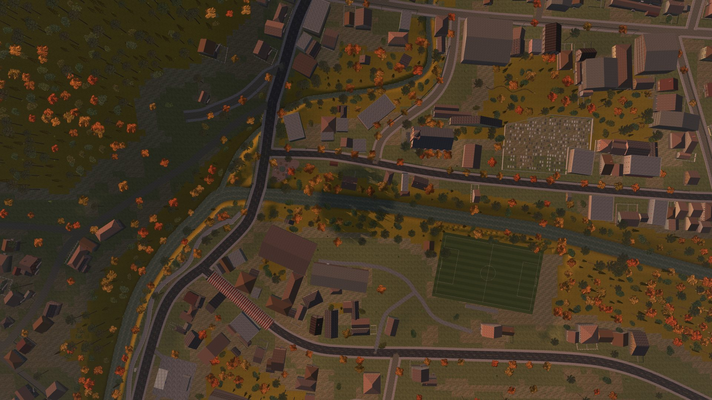</p>

### Dados (`tools/build-mapdata.mjs`, `npm run mapdata`)

| Fonte | Como chega | O que vira |
|---|---|---|
| OpenStreetMap | Overpass API, em duas camadas: a cidade (quadrado de ±1.300 m) e o interior (±2 km): `highway`, `waterway`, `building`, `leisure`, `landuse`, `natural`, `amenity` e pontos com nome | 145 ruas, 9 rios e arroios, 22 áreas, 32 pontos (na cidade: 82, 9, 14 e 28) |
| SRTM 30 m | OpenTopoData, interpolação bilinear, lotes de 100 pontos | cidade: grade larga de 33×33 (100 m, ±1,6 km) e fina de 27×28 (50 m); interior: 50 m em 4 × 4 km e 100 m até ±3,6 km |
| Microsoft Global ML Building Footprints | arquivo do quadkey `210312133`, filtrado pelo centro de cada polígono | 1.328 contornos de prédio (678 na cidade) |

- Origem em −29,4977° / −50,9919° (centro de Santa Maria do Herval), projeção equirretangular
  para metros: x para leste, z para sul, y para cima, arredondado a 0,1 m.
- Tudo fica em cache em `tools/cache/`. O da cidade (`osm.json`, `elev.json`,
  `buildings-ms.json`) fica congelado: a cidade não muda nem com `--refresh`, que só baixa de
  novo o do interior (`*-amplo.json`). Em `mapdata.json`, a parte da cidade vem primeiro em cada
  lista (`v1` guarda quantos são), e o interior vem depois. A saída tem 198 kB.

### Relevo e água (`terrain.js`, `water.js`)

- 380 m de altitude viram y = 0. Cidade: grade de 5 m (253 × 245 vértices, ~1,26 × 1,22 km),
  com interpolação bicúbica do SRTM. Interior: grade de 10 m (3,54 × 3,48 km) em volta, com o
  relevo do interior entrando nos 150 m de fora da cidade e as ruas passando para ele nos 40 m
  de dentro. Longe: grade de 40 m até ±3,4 km, afundada embaixo das grades de detalhe.
- **A cidade não muda com o interior**: dentro da grade dela o relevo, as ruas, o nível dos rios,
  as casas e as árvores saem iguais aos de antes (o interior tem sorteios próprios e fica longe
  da borda). Conferido amostra por amostra contra a versão anterior.
- **Ruas aplainadas**: até 7,5 m da borda o chão segue uma versão suavizada do relevo (média
  de 20 m, 3 passadas) e volta ao normal até 18 m. Praça, igreja, cemitério, campo e posto
  ficam em patamares (`addPad`) que acompanham a altura da rua.
- **Rios escavados**: Rio Cadeia com 9 m de largura e 1,4 m de fundura, arroios com 3 m e
  0,6 m. O nível só desce no sentido da correnteza e o afluente desce até o nível do rio nos
  últimos 40 m. O talude se alarga onde a margem é alta (uns 35°), sem paredões.
- **Grade 4× mais fina perto da água** (células de 1,25 m), costurada nas bordas com as células
  normais para não abrir frestas. A altura do chão usa exatamente os triângulos da malha.
- `drape()` recorta os triângulos do relevo em polígonos (Sutherland–Hodgman) para pisos
  desenhados seguirem o chão.

### Ruas e pontes (`roads.js`)

- Largura por tipo de via (8 m na secundária, 5,5 m na residencial, 1,4 m no caminho),
  pavimento pela tag `surface`, eixo suavizado (Chaikin) e reamostrado a cada 2,5 m.
- Calçadas de 2 m com meio-fio de 15 cm nas ruas principais e no centro; faixa amarela
  tracejada no asfalto das vias maiores.
- **Pontes** aparecem onde uma rua cruza um rio, com o vão calculado pelo ângulo do
  cruzamento, guarda-corpo e piso caminhável.

### Construções (`footprints.js`, `buildings.js`)

1. Cada contorno vira o retângulo de menor área que o cobre. Contornos em L ou mesclados são
   rasterizados numa grade de 1 m e divididos em retângulos.
2. O retângulo gira de 90 em 90° até a frente dar para a rua mais próxima e encolhe ou recua
   até sair da rua, da calçada e do rio.
3. O estilo sai do tamanho e do lugar: fábrica (> 750 m²), comércio na rua principal do centro,
   alvenaria, madeira, enxaimel e galpão em proporções diferentes no centro e na periferia. No
   interior, mais madeira, galpões de tábua (alguns pintados de vermelho, com portão de duas
   folhas) e **aviários**: os prédios compridos e estreitos, com cortina de lona amarela ou azul.
4. Telhados de quatro águas, duas águas (cumeeira em x ou com a empena para a rua), uma água ou
   laje com platibanda; inclinação, telha, reboco e chaminé por sorteio com semente fixa.
5. **Enxaimel**: a textura é repetida uma vez por vão de janela por andar, então as vigas
   escuras ficam alinhadas com portas e janelas.
6. Janelas a cada ~2,6 m na frente; de noite 65% das casas estão "acordadas", cada andar tem
   50% de chance de ter luz e cada janela, 80%.
7. Degrau ou escada com patamar quando a porta fica alta; muro, grade, tijolo, pedra ou cerca de
   ripas com portão diante da porta e calçadinha até a entrada (caminhável).

Os prédios conhecidos (igreja, Prefeitura, Sociedade, museu, posto...) pegam o contorno mais
perto do ponto do OSM. A **Igreja Matriz** tem 18 × 34 m, paredes de 9,5 m e agulha a 40 m.

### Vegetação e mobiliário (`vegetation.js`, `props.js`)

- 9 modelos: araucária, plátano de outono, nativa, pinheiro, cipreste, arbusto, hortênsia e
  duas árvores simplificadas para longe, com folhagem recortada.
- Mata numa grade de 9 m com sorteio (araucária e pinheiro onde o ruído é alto), quintais numa
  grade de 17 m e plátanos ao longo das ruas do centro. No interior, mata numa grade de 11 m
  entre as roças e os pastos (que ficam onde o ruído deixa, mais perto das estradas; a mata
  ciliar fica), árvores nos quintais das casas e morros com árvores simplificadas até 3 km.
- Uma árvore só entra longe de colisores, ruas, rios, prédios, muros e das frentes reservadas.
  Araucárias e plátanos têm tronco com colisão e barram a câmera.
- **Mobiliário organizado** (`spotFree`/`benchFits`): nenhuma peça entra encaixada em outra nem em
  cima do caminho. Banco só com a frente livre até o caminho (sem poste, lixeira, canteiro ou
  grade no meio), e a frente dos bancos, das mesas, da parada e do letreiro fica reservada:
  árvores, postes e placas posteriores desviam dela.
- Postes de 8,5 m a cada 32 m nas ruas do centro, com dois fios em catenária.

### Interior (`countryside.js`)

O campo em volta da cidade, todo com sorteio próprio:

- **Represa da Usina Herval**: o contorno do OSM vira margens ao longo do Rio Cadeia (largura
  medida de cada lado, suavizada, afinando até o rio antes da cidade). O terreno é escavado lá
  dentro (até 3,5 m), a margem desce até a água em 22 m e a represa conta como água funda (nado,
  carro, cães de fogo). O rio por baixo dela não é desenhado.
- **Barragem** de concreto na ponta de baixo, com vertedouro (água e espuma descendo 5 m),
  passarela, guarda-corpo, crista caminhável e a casinha da tomada d'água.
- **Tubulação forçada** de aço enferrujado até a **casa de força** (`USINA HERVAL`, ~100 m
  abaixo): sempre descendo, enterrada onde o morro sobe (sai por uma boca de concreto) e em selas
  e pilares onde o chão afunda.
- **Cercas de arame farpado** (palanque a cada 4 m) na beira das estradas onde há roça ou pasto,
  abrindo nas entradas das casas; **milharais secos** (é maio: a palha ficou na roça) em lotes
  de 48 m com fileiras na mesma direção; **fardos** de palha e de silagem nos pastos.
- Nomes no mapa: REPRESA DA USINA HERVAL, USINA HIDRELÉTRICA HERVAL, VILA AMIZADE e CTG AMIGOS
  DA TRADIÇÃO. O minimapa mostra a represa e os milharais (a 2 m por pixel).

### Interiores (`interiors.js`, `interiors/`)

Montados longe da cidade (x, z ≥ 1.200, altura 400), no mesmo mundo de colisão, escondidos até
o jogador entrar. Entrar e sair passa por uma tela preta, troca os limites da área jogável e o
clima, e usa as 4 luzes mais perto (com tremulação).

| Interior | Arquivo | |
|---|---|---|
| Fábrica de calçados | `factory.js` | 43,4 × 29,4 m: portaria com relógio de ponto, salão, escritório, almoxarifado, caldeira |
| Cripta dos fundadores | `crypt.js` | escada, corredor abobadado com nichos, ossário, sala do sarcófago |
| Gruta do chupacabras | `cave.js` | chão irregular calculado por função, túnel descendo até um salão de ~18 m |
| Igreja Matriz | `igreja.js` | nave, coro com órgão, sacristia, depósito e a torre do sino |

## Física, colisão e chão

- **`CollisionWorld`** (`src/engine/collision.js`): caixas orientadas com faixa de altura
  (prédios, muros; podem ser piso, rampa ou barrar a câmera) e cilindros (troncos, postes), numa
  grade espacial de 8 m. Ruas, rios, calçadinhas e muros usam índices de segmentos à parte.
- **O chão**: `surfaceAt(x, z)` é o maior entre o relevo, a rua desenhada, a calçada elevada e os
  pisos em `ctx.floors`; `groundAt(x, z, pés)` sobe até a caixa caminhável mais alta que esteja
  no máximo 0,45 m acima dos pés. Todo piso desenhado acima do terreno precisa entrar no chão do
  jogador (`ctx.floors`, `ctx.walkways` ou uma caixa caminhável), senão as pernas somem dentro dele.

| Jogador (`src/game/player.js`) | |
|---|---|
| Velocidade | andar 1,75 m/s, correr 7,2, mirando 1,3, nadando 1,35 (2,3 correndo) |
| Corpo | cilindro de 0,32 m de raio e 1,7 m de altura |
| Degraus | sobe 0,45 m sem pular; o passo é dividido a cada 0,12 m e para se o chão subir mais de 0,5 m |
| Pulo | 4,6 m/s com gravidade de 13 m/s² (~0,81 m de altura) |
| Água | até a cintura anda (35% mais devagar andando, 60% correndo, conforme a fundura); nada com mais de 1,05 m e volta a andar com menos de 0,9 m |
| Esquiva | 0,36 s a 10 m/s, invencível por 0,3 s, espera 0,5 s |

- **Tiros** (`castRay`, `src/game/weapon.js`): o raio testa os alvos, depois caixas e cilindros
  (a cada 2 m) e por fim o chão e a água (passos de 0,6 m e 8 bissecções). A superfície acertada
  decide o efeito: madeira, metal, parede, rua, terra ou água.
- **Câmera**: um raio do alvo até a câmera contra os colisores que barram a vista; ela encosta a
  no mínimo 0,6 m e fica 0,35 m acima do chão e da água.

## Personagens e animação

<table>
  <tr>
    <td width="50%">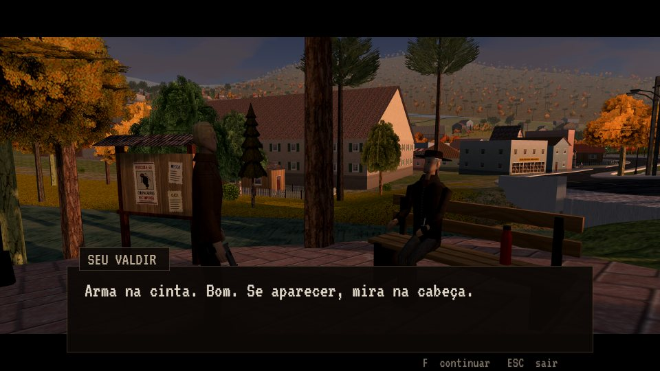<br><sub>Conversa: câmera de lado, texto letra a letra e voz em bipes</sub></td>
    <td width="50%">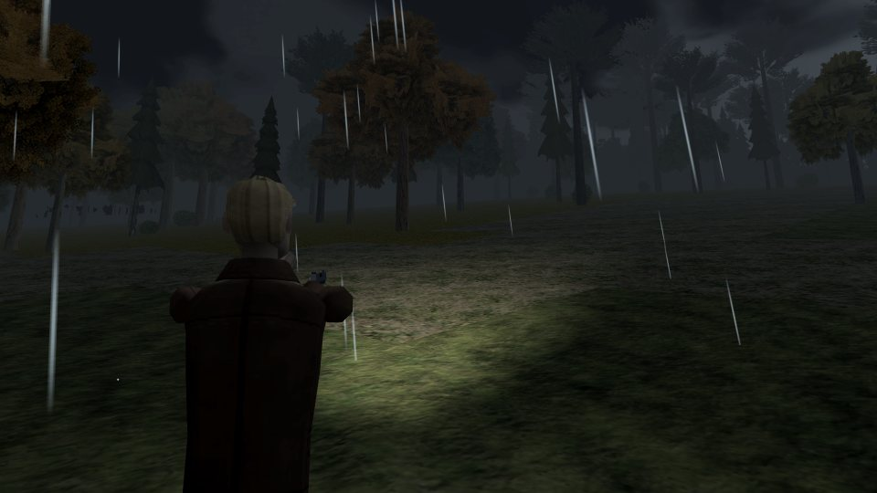<br><sub>Mirando na chuva: câmera no ombro, nivelada, e a lanterna em foco (a luz 0 do shader)</sub></td>
  </tr>
</table>

- **Protagonista** (`src/game/character.js`): um único `SkinnedMesh` de 1.201 triângulos com
  18 ossos (quadril, coluna, pescoço, cabeça e, de cada lado, ombro, cotovelo, mão, coxa,
  joelho, tornozelo e dedos). Os anéis de cotovelo e joelho dividem o peso entre dois ossos,
  então a junta dobra sem abrir. A oclusão vem assada nas cores dos vértices por cápsulas, e
  a textura é pintada no carregamento (atlas em 256 px: rosto com pincel macio, roupa em pixel
  art com o grão das fotos de tecido).
- **Caminhada procedural com IK**: frequência e duração do passo saem da velocidade; o pé apoiado
  fica plantado e rola do calcanhar para a ponta; IK analítico de dois ossos em cada perna, com o
  joelho apontado; o quadril só desce até onde a perna alcança. Por cima: pouso com mola,
  inclinação nas curvas e na aceleração, respiração, troca de apoio parado, olhar desconfiado em
  volta e nado de peito ou boiando (tabelas de pose).
- **Moradores** (`src/game/npcs.js`, `npcData.js`): usam a mesma geometria (guardada uma vez) e o
  mesmo esqueleto, com textura pintada para cada um e acessórios presos aos ossos (chapéu, cabelo,
  saia, objeto na mão). As **fichas** (`FICHAS`) dão altura, porte (magro 0,92 a gordo 1,14 de
  largura), corcunda e traços do rosto (rugas, olheiras, sardas, barba, cicatriz); as mesmas
  fichas geram a página de personagens do site.
- **Gestos** (`npcActs.js`): IK de braço (o punho vai a um ponto, o cotovelo aponta para um lado)
  e 27 ações que começam e terminam sozinhas: cruzar os braços, abraçar o corpo de frio, coçar a
  nuca, rezar, fazer o sinal da cruz, olhar o relógio, telefonar, mexer a panela...
- **Comportamento**: um tiro ou explosão assusta quem está perto (até 34 m), que foge a 4,3 m/s
  por 5 a 7 s, fica abalado e desconfiado por 45 s (recua se o jogador chegar com a arma na mão);
  mirado, levanta as mãos; o sino faz todos olharem para a igreja (com o atraso do som, d/340).
  Moradores a mais de 140 m ficam parados.
- **Diálogo** (`src/ui/dialogue.js`): 32 letras por segundo em páginas de 3 linhas, com um bipe
  grave a cada duas letras no tom de cada morador.
- **Criaturas**: peças rígidas presas a juntas, como nos primeiros jogos de PS1
  (`src/game/creatures/shapes.js`: sólidos de revolução com cor por vértice, membros e cones).
  O chupacabras tem ~900 triângulos.

## Combate, armas e criaturas

- **Tiros são instantâneos** (*hitscan*): um raio da câmera acha o ponto mirado e outro sai do cano
  até ele. As criaturas têm **esferas de acerto** presas aos ossos; na cabeça o tiro vale o dobro.
- **Golpes** acertam por alcance, um cone à frente e uma faixa de altura, entre 36 e 64% do
  movimento. Combo de três socos (o terceiro é um *uppercut*), *hit-stop* de 0,055 s (0,09 s no
  terceiro e nas armas pesadas).
- **Vida**: 100. Depois de 8 s sem dano volta sozinha até 40, a 3 por segundo. Cuca cura 35,
  chá de marcela 70. Inventário de 16 espaços (grade 4×4).

| Arma | Pente | Dano | Recarga | Detalhes |
|---|---|---|---|---|
| Pistola 9 mm | 12 | 1 | 1,35 s | 0,17 s entre tiros, alcance 160 m, a mira abre com tiros seguidos |
| Espingarda | 2 | 8 × 0,9 | 1,6 s | chumbo espalhado, alcance 45 m |
| Revólver .38 | 6 | 2,5 (prata) | 2,1 s | alcance 160 m |
| Pistola de raios | 8 | 3 | — | projétil a 46 m/s; a carga volta sozinha (1,1/s) |
| Rifle de dardos | 1 | 0,3 | 1,3 s | alcance 90 m; só derruba bicho cansado |
| Lampião bento | — | 2,4/s | — | feixe de 9,5 m; querosene acaba em ~18 s de uso |
| Dinamite | — | 7 | — | pavio de 1,9 s, raio de 4,8 m; fere o jogador também |

| Arma branca | Dano | Usos |
|---|---|---|
| Mãos (combo) | 0,6 · 0,6 · 1,25 | — |
| Coronhada | 0,9 | — |
| Pedaço de pau | 1,15 | 14 |
| Cano de ferro | 1,5 | 22 |
| Pá | 1,75 | 18 |
| Foice | 2,1 | 16 |
| Machado | 2,9 | 14 |
| Pedra / tijolo (arremesso) | 1,4 / 1,9 | carrega até 6 / 4 |

**Resistências** (`src/game/creatures/base.js`): cada criatura multiplica o dano por tipo. O padrão
é bala 1, prata 1, golpe 1, luz 0,15, raio 1, explosão 1, dardo 0,2 e fogo 1; um escudo
multiplica tudo (menos a luz) por 0,1, e um valor quase zero é imunidade (faísca e som de "não
pegou"). A dificuldade entra multiplicando o dano que as criaturas recebem.

Cada criatura é uma **máquina de estados** em texto (`this.state`: `prowl`, `chase`, `windup`,
`leap`, `recover`...) com os ganchos `build()`, `think()` e `animate()`. Em bando, um limite evita
que todos ataquem juntos (no máximo 2 cães, 2 morcegos ou 2 ETs de cada vez). Antes do bote vem
um aviso: o cão agacha rosnando, o morcego guincha, o chupacabras agacha chiando (e um tiro nessa
hora cancela o bote dele).

<details>
<summary><b>Criaturas e chefes</b> (contém spoilers)</summary>

| Criatura | Vida | Regras |
|---|---|---|
| Chupacabras (capítulo 1) | 9 | cabeça ×2; com a vida no fim, foge ferido |
| Cão de fogo | 3,2 | imune a fogo, explosão ×1,4; apaga na água |
| Morcego gigante | 2 | rodeia no alto, guincha e mergulha |
| Rainha dos morcegos | 45 | mergulho, grito, chama morcegos; pousada leva ×1,5 |
| Fantasma | 2,5 | bala, golpe e dardo atravessam; luz ×1, prata ×0,5; passa pelas paredes |
| Capataz | 30 | escudo; a luz do lampião acumula e, cheia, ele cai de joelhos por 6 s |
| ET | 3 | raio ×0,5; orbes psíquicos |
| O Visitante | 40 | escudo cai com 3 raios ou 1 explosão e fica 7 s aberto |
| A Fera | 60 | bala ×0,5, golpe ×0,55, explosão ×2; batendo na coluna fica tonta 2 s e leva ×1,6 |
| Lobisomem | 40 | bala ×0,12, prata ×1,6; regenera 1,5/s sem levar prata por 4 s; uivando leva ×1,5 |
| O Coveiro / A Mulher da Fotografia | 12 / 16 | fantasmas-chefe dos capítulos 8 e 9 |
| Chupacabras (capítulo 11) | — | cansado, o dardo funciona; dois dardos e ele dorme |
| Bruxa Otília | 90 | voa, escudo de 90%; três fases (66% e 34%); exausta depois dos rituais; não morre: é selada com a cruz |

</details>

### Mira assistida (`src/game/aimAssist.js`)

Só no controle e no toque (no teclado e mouse nada muda). Opção MIRA ASSISTIDA:

| | Normal | Forte |
|---|---|---|
| Cone do puxão ao mirar | 0,42 rad | 0,65 rad |
| Cone do tiro sem mirar | 0,6 rad | 0,85 rad |
| Alcance | 40 m | 52 m |
| Câmera mais lenta sobre o alvo | 45% | 60% |
| Ímã para a esfera de acerto | 0,05 rad | 0,085 rad |

- L2 / MIRAR puxa a mira até o bicho mais perto do centro da tela.
- Atirar sem mirar trava no bicho à frente e o tiro vai nele.
- Sobre o alvo a câmera gira mais devagar e acompanha o bicho que anda (e o
  jogador que anda de lado); perto dele a mira escorrega até a esfera de acerto
  mais próxima, cabeça incluída.
- A bala que passaria raspando vai no ponto de acerto mais perto; se o tiro já
  pega em algo (a cabeça, por exemplo), vai onde está mirado.
- Segurar R2 / ATIRAR continua atirando, mais devagar do que apertando.
- A linha de visão de cada alvo fica guardada por 150 ms; um movimento forte do analógico
  cancela o puxão.

## O carro

`src/game/car.js` (física, entrar e sair, luzes, efeitos), `carModel.js` (a malha),
`carAudio.js` (os sons), `carIntro.js` (a chegada na abertura) e
`src/engine/heroCarTextures.js` (texturas). Há um carro só, o do protagonista, e ele não gasta
combustível.

**Modelo.** Um sedã preto de quatro portas sem coluna do meio, do fim dos anos 60, sem nenhuma
marca: capô comprido, grade de lado a lado com faróis duplos, três lanternas de cada lado, frisos
e para-choques cromados, banco inteiriço de couro cor de vinho. A lataria é montada por seções
ao longo do carro (estações nas caixas de roda e nas emendas das portas), com normais suaves e
quina viva no vinco da cintura, que sobe no paralama de trás. A lateral inteira é uma textura só,
com vincos, maçanetas, frisos e lanternas laterais no lugar da malha. O brilho da lataria, do
cromado e dos vidros vem do material PS1 com `gloss`: reflexo de mentira (chão escuro, horizonte
claro, céu), brilho do sol (apagado pela sombra) e das luzes dinâmicas, mais forte de lado. A
porta do motorista, o volante e as quatro rodas são peças separadas.

**Física** (fliperama, sem biblioteca). Modelo de bicicleta: o giro sai do esterço e da distância
entre eixos, limitado pela aderência; a velocidade guarda a direção do mundo e o que sobra de lado
morre pela aderência do piso, então no paralelepípedo molhado, na terra ou no freio de mão a
traseira escapa. Aderência e atrito por piso (asfalto, concreto, calçada, paralelepípedo, terra,
grama, folhas, água; a chuva tira até 32%). Motor limitado pela aderência, câmbio automático de
três marchas, ré segurando o freio parado, ladeira (a gravidade puxa ao longo do carro). As quatro
rodas leem o chão: a carroceria fica numa mola (afunda no meio-fio, mergulha na freada, levanta na
arrancada, inclina na curva) que só desce com a gravidade, então o carro pula nas lombadas do morro.
Água funda afoga o motor.

**Batidas.** O contorno do carro (caixa de 5,5 × 2 m) contra as caixas e os círculos da grade de
colisão, em passos de 22 cm: teste de eixos separados para caixas, ponto mais perto para círculos,
e impulso no ponto de contato, então bater de quina faz o carro girar. Batida forte faz faísca,
amassa (o carro solta fumaça, os faróis falham e, bem batido, anda devagar) e assusta quem está
perto. O carro também é uma caixa móvel na grade (`CollisionWorld.moveBox`): moradores,
criaturas e o protagonista a pé esbarram nele.

**Moradores e criaturas.** Quem está no caminho (até 1,7 s de distância) pula para o lado mais
perto e grita (`NPC.dodgeCar`); quem não sai (sentado, já pulou) faz o carro frear sozinho, e se
encostar o carro para nele como num poste, sem ferir ninguém, e o morador reclama. Criaturas são
atropeladas acima de 11 km/h (dano pela velocidade, o bicho voa longe); as grandes (Fera,
lobisomem, chefes) seguram o carro e o amassam. Fantasmas atravessam. Dentro do carro o golpe
das criaturas fere menos e ninguém é jogado longe.

**Entrar e sair.** Perto do carro aparece ENTRAR NO CARRO; ele anda até a porta (dando a volta se
estiver do outro lado), abre, se abaixa e senta (pose por IK: quadril no banco, pés nos pedais,
mãos no volante, que gira junto), puxa a porta e dá a partida. Saindo: solta o volante, abre a
porta, põe as pernas para fora, levanta e fecha a porta. Cena, morte, teletransporte ou capítulo
novo tiram ele do carro na hora (`Player.place`). A câmera do carro fica atrás, olha um pouco à
frente, se afasta e abre o campo de visão com a velocidade e volta sozinha para trás do carro.

**Luzes e efeitos.** Faróis acesos de noite, na neblina e na chuva (ou pelo botão): a luz 0 do
shader vira um foco à frente do carro, com brilho nas lentes e um facho que aparece na neblina;
lanternas e luz de freio vermelhas no chão atrás. Fumaça do escapamento, fumaça e marcas de pneu
na derrapagem, poeira e torrões na terra, água espirrando nas rodas.

**Som.** Motor V8 sintetizado (dente de serra nas explosões, o galope da marcha lenta, admissão
abrindo com o acelerador), partida, troca de marcha, pneu cantando, ronco do asfalto, trepidação
do paralelepípedo, cascalho, vento, chuva no teto, buzina, portas, batidas e atropelos. Dentro do
carro o ambiente fica abafado (`Audio.setMuffle`). Medidos no `npm run sons` (grupo carro).

**Salvamento.** O carro fica onde foi deixado (posição e dano no save). Num capítulo novo, se ele
estiver longe da partida, aparece estacionado na beira da rua mais perto, consertado.

## Campanha, salvamento e dificuldade

O capítulo 1 é `src/game/mission.js`; os outros ficam em `src/game/chapters/`, um arquivo por
capítulo, todos com o mesmo formato:

```js
export default {
  n: 5, key: 'fera', title: 'A Fera da Madrugada', weather: 'madrugada',
  start(G) { return { x, z, h }; },          // onde o jogador começa
  setup(G, S) {},                             // monta o cenário
  steps: [{
    id, obj, marker,                          // objetivo e marca na tela e no minimapa
    enter(G, S) {}, update(G, dt, S) {},      // update devolve true = próxima etapa
    exit, onRespawn, resumeAs,
  }],
  // opcionais: saveState, loadState, tick, cleanup, onEnter, onExit, drawHud...
};
```

A `Campaign` (`src/game/campaign.js`) dá aos capítulos uma API pequena: `talk`, `say`,
`narrate`, `showPaper`, `cut` e `camAt` (cenas), `spawn` e `wave` (criaturas em ondas), `boss`,
`checkpoint`, `give`, `pickup`, `enter`/`leave` (interiores) e `complete`. O código que depende
da história usa a chave do capítulo (`key`), não o número.

### Salvamento

```js
// localStorage['teewald.save.v1']
{
  version: 2, chapter, unlocked,
  ranks: { 1: 'A', 2: 'S' },                  // melhor nota de cada capítulo
  totals: { kills, deaths, time },
  inv: { slots: [{ id, n, data }], equipped }, // data: por exemplo, balas no pente
  melee: { id, dur, n },
  run: {                                       // a partida em andamento
    chapter, step,                             // capítulo e etapa
    pos: { x, z, h, y },                       // só se for seguro; senão vale o ponto de retorno
    cp, indoor, hp,
    flags,                                     // só valores simples
    custom,                                    // o que o capítulo guarda (saveState)
    stats: { kills, deaths, t },
  },
}
```

- **Quando salva**: ao começar o capítulo, ao trocar de etapa, em cada ponto de retorno, a cada
  20 s, ao cair, ao terminar o capítulo, ao sair para o menu e ao esconder ou fechar a aba (no
  máximo um salvamento a cada 2 s, e nunca morto). A posição só é guardada fora de luta, no chão,
  fora da água e sem chefe vivo.
- **Migração**: saves sem `version` (de quando havia dez capítulos) são renumerados por uma
  tabela (6→7, 7→8, 8→10, 9→11, 10→12), porque os capítulos 6 e 9 entraram no meio.
- **Nota do capítulo**: S = nenhuma queda e 12 ou mais criaturas; A = nenhuma queda; B = até 2
  quedas; C = mais.
- Documentos, lendas e pedidos ficam em `teewald.extras.v1`; as opções, em `teewald.settings.v1`.

### Dificuldade (`src/game/difficulty.js`)

| | Dano recebido | Dano nas criaturas | Chance de largar algo | Munição depois de cair |
|---|---|---|---|---|
| FÁCIL | ×0,55 | ×1,35 | 60% | ×1,5 |
| NORMAL | ×1 | ×1 | 40% | ×1 |
| DIFÍCIL | ×1,4 | ×0,85 | 28% | ×0,6 |

## Som

Tudo é sintetizado com Web Audio (`src/engine/audio.js`, `src/game/gunAudio.js`,
`src/game/creatures/sfx.js` e um pouco em cada criatura): osciladores, dois ruídos em laço
(marrom e branco), filtros, atrasos e um *waveshaper*. Nenhum arquivo de áudio. O contexto só
começa no primeiro toque ou tecla (exigência do iOS) e é suspenso quando a aba fica escondida.

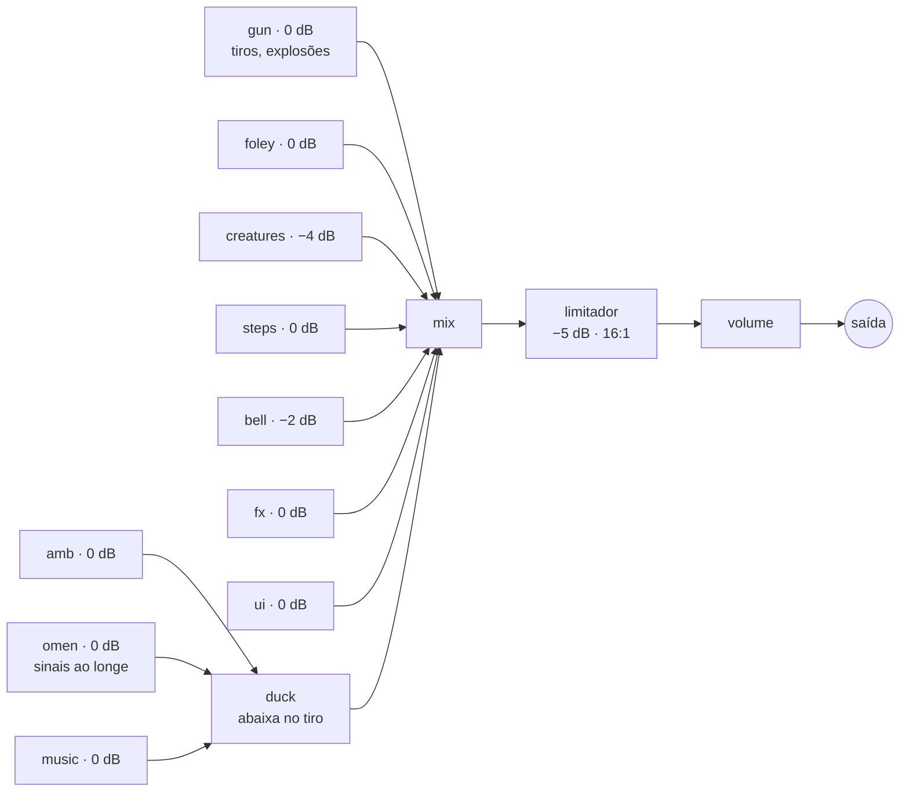

- **10 barramentos** (`MIX`, no começo de `audio.js`) e um limitador (compressor a −5 dB,
  razão 16:1, ataque 2 ms, soltura 200 ms), então nada estoura.
- **O tiro é o som mais alto** e abaixa ambiente, sinais e música por um instante (−8 dB na
  pistola, −10 na espingarda, até −12 na explosão).
- **Eco do vale**: um atraso com filtro passa-baixa de 1 kHz na realimentação, com tempo,
  realimentação e mistura diferentes por arma, mais uma cauda de ruído.
- **Posição**: `StereoPannerNode` pelo lado em relação à câmera e volume caindo com a distância
  (até 90 m nos tiros, 70 m nas criaturas); as corujas também ficam mais abafadas longe.
- **Dentro de casa**: chuva abafada (passa-baixa de 9 kHz para 700 Hz), vento a 22%, sem rio,
  grilos nem pássaros, trovão abafado em 260 Hz.
- **O sino**: 7 parciais de bronze sobre 196 Hz, cada uma com uma gêmea desafinada para dar o
  batimento; mais forte e claro perto da torre, abafado dentro de casa.
- **Música**: a tensão da luta é um pulso grave de dente-de-serra que bate como coração (mais
  rápido nos chefes); a bandinha fantasma toca uma valsa original em lá menor, 3/4, com
  acordeão, tuba e clarinete.
- Camadas contínuas: vento em dois canais, folhas, rio, zumbido grave, chuva; e, ao longe,
  corvos, cachorros, quero-quero, bem-te-vi, pombas, sapos e grilos.

## Idiomas

Português, inglês, espanhol e alemão (OPÇÕES → IDIOMA / LANGUAGE; na primeira vez vale o
idioma do navegador, e `?lang=en` força pela URL). O texto fica escrito em português no código
e é traduzido só na hora de desenhar (`src/i18n/index.js`), pelos dicionários
`src/i18n/en.js`, `es.js` e `de.js`. `npm run traduzir` acha os textos novos no código e
atualiza os dicionários, e diz quanto falta traduzir. O tom e o glossário estão em
`src/i18n/GUIA.md`. Nomes, lugares, placas pintadas no cenário e frases em hunsrik ficam
como estão. `npm run teste -- --idioma=en` joga a campanha em inglês e lista o texto que
apareceu na tela sem tradução.

Como funciona por dentro:

- **`tr(texto)`** procura, nesta ordem: texto que já é uma tradução, a chave exata, a versão em
  maiúsculas, os **moldes com `{1}`, `{2}`** (compilados em expressões regulares, com os pedaços
  traduzidos de novo e podendo mudar de ordem), o texto sem espaços nas pontas e, por fim, os
  pedaços separados por `·`, `—`, `:`, parênteses e números. O resultado fica em memória. O que
  não acha vai para `missing`.
- **Só no desenho**: `textSprite`/`drawText` (`src/ui/overlay.js`) e as placas 3D, refeitas quando
  o idioma muda. Texto quebrado em linhas ou letra a letra é traduzido antes de quebrar.
- **Dicionários sob demanda**: `import()` dinâmico; o português não carrega nada.
- **`npm run traduzir`** lê o `src/` com o analisador de JS do Rolldown (árvore sintática, não
  expressões regulares): pega textos, *template strings* (cada `${}` vira `{n}`) e concatenações,
  e descarta ids, nomes de arquivo, CSS, GLSL e afins. As chaves ficam agrupadas por arquivo; as
  que sumiram do código saem. Também exporta e importa lotes (`--exportar`, `--importar`).
- **Texto montado no código** que só aparece jogando vai para a parte `extra`: o
  `npm run teste -- --idioma=en` grava o que faltou e `npm run traduzir -- --vistos <arquivo>`
  o acrescenta.
- Hoje: 1.566 textos em cada dicionário; 16 ou 17 por idioma ficam em português de propósito
  (`null`: texto que o jogador não vê).
- No jogo, o texto é desenhado em canvas: Grenze Gotisch nos títulos, VT323 na interface,
  Special Elite nos documentos oficiais e Caveat nos bilhetes à mão; no PS1 o alfa vira binário,
  como nas fontes de pixel.

## Controles e entrada

| Ação | Teclado / mouse | Controle | Toque (celular/tablet) |
|---|---|---|---|
| Andar | WASD ou setas | analógico esquerdo | arrastar no lado esquerdo |
| Correr | Shift | B (segurar) · L3 (liga até soltar o analógico) | botão CORRER (liga/desliga; desliga a mira) |
| Pular | Espaço | A | botão PULAR |
| Esquiva | C ou Ctrl | B (toque rápido; mirando, na hora) | botão ESQUIVA |
| Câmera | mouse (clique na tela para prender) · Q/E | analógico direito | arrastar no lado direito ou no ATIRAR |
| Centralizar câmera | — | R3 | toque duplo no lado direito |
| Distância da câmera | roda do mouse | direcional ↓ (perto, normal, longe) | pinça com dois dedos |
| Conversar (perto de um morador) | F | A | botão FALAR sobre o morador |
| Ler / examinar / pegar / entrar | F ou E | A | botão sobre o objeto (LER, PEGAR, ENTRAR...) |
| Inventário | I ou Tab | Y | botão INV |
| Golpe (soco, arma branca, arremesso) | V · botão esquerdo sem arma de fogo | RB | botão GOLPE |
| Trocar de arma | 1 a 8 (1 = mãos) | direcional ◀▶ | botão ARMA |
| Comer / beber (cura) | H | direcional ↑ | botão CURA (aparece ferido) · inventário |
| Mirar (com arma de fogo) | botão direito (segurar) | L2 ou LB (segurar) | botão MIRAR (liga/desliga) |
| Atirar (segurar: luz do lampião) | botão esquerdo | R2 (segurar: continua atirando) | botão ATIRAR (segurar: continua) |
| Recarregar / reabastecer | R | X | botão REC |
| Pausa | Esc ou P | Start | botão ❚❚ |
| Arquivos, lendas e pedidos | J | Start → ARQUIVOS | ❚❚ → ARQUIVOS |
| Minimapa (liga/desliga) | M | Select | Opções |
| Tela cheia | F11 | — | botão ⛶ (Android e iPad) |
| Mostrar FPS | F3 | — | — |
| Entrar no carro (perto dele) | F ou E | A | botão ENTRAR NO CARRO |
| Acelerar · frear e ré | W · S (ou setas) | R2 · L2 (pela pressão) | ACELERAR · FREIO |
| Volante | A / D | analógico esquerdo | arrastar no lado esquerdo |
| Freio de mão | Espaço | B | F. DE MÃO |
| Buzina · farol | G · L | X · direcional ↑ | BUZINA · FAROL |
| Olhar para trás (dirigindo) | C | LB | — |
| Sair do carro | F ou E | A | SAIR |

Menus: setas/ENTER, direcional/A/B (segurar repete), clique ou toque. Na pausa,
START ou P de novo voltam ao jogo.

Dirigindo, a ré entra segurando o freio com o carro parado. No toque, os botões de andar viram
os do carro nos mesmos lugares, e SAIR e FAROL ficam na barra de cima. As duas primeiras vezes
que ele entra no carro aparecem as dicas de como dirigir.

Atirar sem mirar levanta a pistola, atira e mantém a mira por um instante.
Mirando, o personagem anda devagar em qualquer direção e a câmera vai para o
ombro direito, nivelada (a câmera normal olha de cima; sem isso a mira apontava
para o chão). O coice sobe a câmera e ela volta sozinha. Um aperto no intervalo
entre tiros fica guardado e sai assim que a arma deixa.

O analógico direito tem zona morta circular e curva de precisão: pouco inclinado
gira bem devagar (mira fina); segurado no máximo fora da mira, o giro acelera
para dar meia-volta. O controle vibra nos tiros, golpes, dano e explosões
(opção VIBRAÇÃO). No toque, arrastar o dedo que está no ATIRAR também gira a
câmera: mira e tiro com o mesmo polegar.

No celular o jogo entra em tela cheia ao tocar na tela inicial (Android) e fica
melhor deitado; em pé, a imagem fica em 4:3 no alto e os controles embaixo.
Dá para jogar no celular com controle Bluetooth: os botões da tela somem quando
o controle é usado e voltam ao tocar na tela.

Os menus no toque (`src/ui/touchMenu.js`) usam botões grandes na tela inteira:
o botão acende ao encostar e só age ao soltar em cima dele. Em Opções cada linha
tem ◀ e ▶ (deitado, em duas colunas; arrastar rola se não couber), e há opções
só do celular: **tamanho dos botões** (pequeno, médio, grande) e **vibração**
(Android; também aparece com controle que vibra). Sair da partida pela pausa
pede confirmação. Em pé, o inventário
mostra as ações do item em botões grandes na parte de baixo; em EXAMINAR,
arrastar gira o item.

Por dentro (`src/engine/input.js`, `src/engine/touch.js`, `src/game/camera.js`):

| | |
|---|---|
| Controle | Gamepad API lida a cada quadro, mapeamento padrão; o controle só conta como ativo depois de usado |
| Analógico esquerdo | zona morta 0,18 |
| Analógico direito | zona morta circular 0,15, borda 0,95, curva com expoente 1,8; segurado no máximo, o giro acelera até 1,75× |
| Gatilhos | com histerese: L2 liga acima de 0,3 e solta abaixo de 0,15; R2, 0,4 e 0,22 |
| Vibração | `vibrationActuator.playEffect('dual-rumble')` no controle; `navigator.vibrate` de 8 a 14 ms nos botões do celular |
| Câmera | distâncias de 2,8, 4,6 e 6,8 m (roda/pinça de 2,2 a 9 m); recentraliza sozinha depois de 1,4 s parada |
| Mirando | câmera 0,5 m para o ombro direito a 1,7 m, campo de visão de 58° para 46°, sensibilidade 45 a 50% menor |
| Toque | analógico flutuante (zona morta 0,12), toque duplo em até 330 ms, botões de no mínimo 44 px |
| Tela | Screen Wake Lock durante o jogo, para o celular não apagar |

## Ferramentas e testes

As ferramentas que abrem o jogo usam o puppeteer-core com o Chrome (ou o Edge) instalado, sem
janela, quase sempre com o SwiftShader (renderização por software, para rodar em qualquer
máquina). Elas comandam o jogo pelo `window.__teewald` ([depuração](#depuração)): `simulate`
avança o tempo sem desenhar, `teleport` e `view` mexem no jogador e na câmera. Não há framework
de teste unitário: o robô da campanha é o teste de regressão.

### Teste da campanha (`npm run teste`)

Testa a campanha inteira sozinho: compila o jogo, abre num Chrome
sem janela e um robô passa por todas as etapas dos doze capítulos até os créditos
(pula falas e cenas, derruba as criaturas, usa os pontos da história). Em cada
etapa ele salva e volta pelo CONTINUAR, e uma vez por capítulo deixa o jogador cair,
conferindo se o jogo volta para a mesma etapa. No fim mostra onde travou e os erros
do console. `npm run teste -- 6` começa no capítulo 6, `npm run teste -- 6 6` testa só
ele e `--rapido` usa a última compilação (`tools/test-campaign.mjs` e
`tools/campaign-bot.js`).

- Compila com `vite.build()` em `node_modules/.teewald-teste` e serve com `vite.preview()` na
  porta 4317, numa janela de 640×480 sem som.
- O robô roda dentro da página: a cada 0,5 s de jogo simulado lê a etapa atual e faz o mínimo
  para ela andar (vai até a marca, usa o ponto de interação, conversa, fere as criaturas com o
  tipo de dano certo). O jogador fica invencível.
- Uma etapa parada por 240 s de jogo conta como travada (o robô força a passagem e anota);
  cada capítulo tem no máximo 900 s. O comando só termina com código 0 se nada travou e o console
  ficou sem erro.

### Auditoria do mundo (`npm run audit`)

Com o jogo rodando (`npm run dev`), faz uma revisão técnica do mundo: lista
superfícies enterradas no terreno (mais de 5 cm), pisos flutuando (0,35 a 2 m), objetos
encaixados uns nos outros, árvores e objetos no meio da pista e lugares onde os pés do jogador
afundariam no chão desenhado (ou flutuariam acima dele), numa grade de 1 m sobre toda a área
jogável.

### Medidor de som (`npm run sons`)

Toca cada som do jogo num Chrome sem janela e mede o volume (LUFS) de cada um em relação ao tiro
de pistola (`npm run sons -- passo sino` mede só os que têm essas palavras no nome).

- Sobe um servidor do Vite, importa os módulos de som do jogo numa página vazia e troca o
  `AudioContext` por um `OfflineAudioContext` estéreo a 48 kHz: renderiza mais rápido que o tempo
  real e sem caixa de som.
- Ponderação K da ITU-R BS.1770 (dois biquads), janela de 400 ms (*momentary*) e de 100 ms, passo
  de 10 ms; sons contínuos usam a média entre 7 e 11 s. Mostra o pico em dBFS e avisa ESTOURA
  acima de −0,1.
- 105 sons em 7 grupos (armas, jogador, criaturas, ambiente, sino, mundo, interface). `--cru`
  tira o limitador; `--json arquivo` grava o resultado.
- Pegadinha: o limitador do Chrome aperta demais no começo do contexto, então tudo começa 0,5 s
  depois e a análise pula esse trecho.

### Capturas, retratos e exportação

- `npm run shot` (`tools/screenshot.mjs`): uma captura com consulta na URL, JS antes e espera.
  `tools/shots.mjs` faz várias na mesma sessão a partir de uma lista JSON.
- `npm run capturas` e `npm run retratos`: veja [Site do jogo](#site-do-jogo).
- `npm run social` (`tools/social.mjs`) faz as peças do Instagram em `social/`, sem spoiler
  como o site. O plano da campanha, as legendas e o calendário ficam em `social/CAMPANHA.md`
  e a prévia do perfil em `social/previa.html`.
  - **Fotos** (`tools/social/fotos.mjs`): o jogo desenha com o dobro de pixels (post de
    2160×2700, story de 1620×2880), sem o limite de 1440 linhas do 3D limpo. As telas com
    interface saem em 4:3, e a do celular sai numa página de celular deitado, com toque.
  - **Posts e stories** (`tools/social/posts.mjs`): montados em `tools/social/molde.html`
    com os tokens e componentes do site.
  - **Reels** (`tools/social/roteiro.mjs`): o jogo roda quadro a quadro. `relogio.js` toma
    conta de `requestAnimationFrame` e de `performance.now`, e `gravador.js` passa a tela
    pelo `VideoEncoder`. O som é o do motor de áudio do jogo num `OfflineAudioContext` que
    para a cada quadro, então cada sino, tiro e trovão cai no quadro certo. `mp4.mjs` monta o
    H.264 + AAC sem dependências. No fim, o gravador decodifica o próprio vídeo e imprime o
    brilho médio de cada segundo.
  - Partes: `npm run social -- fotos | posts | reels`; `-- fotos capa chuva` refaz só essas.
- `npm run exportar` grava `exportados/teewald-protagonista.glb` (glTF binário), que abre no
  Blender (Arquivo → Importar → glTF 2.0) com textura e esqueleto; com o jogo aberto,
  `__teewald.exportar()` no console baixa o mesmo arquivo. O modelo vem na pose de repouso, em
  metros (1,73 m, pés em y = 0, olhando para +z), com a textura do 3D limpo (256 px) e 18 ossos
  nomeados com `.L`/`.R` (`ombro.L`, `joelho.R`...). A sombra de oclusão vai na cor dos vértices
  (convertida para linear); se ela não aparecer no Blender, ligue um nó *Color Attribute*
  multiplicando a *Base Color*. **Limite:** a animação do jogo é procedural (IK em código),
  então o arquivo leva o esqueleto mas nenhum clipe de animação. O código fica em
  `src/engine/exporter.js` (`GLTFExporter`), carregado só quando chamado.
- `npm run texturas` (`tools/texturas.mjs`) grava em `texture-templates/<personagem>/` o atlas
  que `src/game/heroTexture.js` pinta: `atlas.png` (o arquivo do jogo, 256 px no protagonista e
  128 nos moradores), `atlas-ampliado.png` (1024 px sem suavizar), `mapa.png` (com o contorno e o
  nome de cada parte) e `partes/` (tronco, manga, perna, cabeça... recortados do ampliado). Sem
  argumento sai o protagonista (`forasteiro`); `npm run texturas -- arno hilda` faz os moradores
  pelo id de `src/game/npcData.js`. É só para ver: o jogo não lê essa pasta.

## Build, publicação e sincronização

- **Vite** (`vite.config.js`): `base: './'` (funciona em qualquer subpasta), `publicDir: 'texture'`,
  porta 5173 e um plugin que copia `site/` para `dist/site/` sem passar pelo Vite, refaz as
  versões em markdown para LLMs e põe `sitemap.xml`, `llms.txt` e `llms-full.txt` na raiz.
  Duas páginas de entrada: o jogo (`index.html`) e a lista completa dos personagens
  (`personagens/index.html`).
- **Divisão do código**: só quatro pedaços saem do arquivo principal, carregados sob demanda.

  | Arquivo | Tamanho | gzip |
  |---|---|---|
  | `index.js` (jogo + three) | 1.786 kB | 589 kB |
  | `en.js` / `es.js` / `de.js` | 120 / 123 / 126 kB | 51 / 49 / 53 kB |
  | `exporter.js` (GLTFExporter) | 38 kB | 11 kB |

  A pasta `texture/` vai inteira para o build (807 arquivos, 126 MB), mas o jogo só baixa as
  cerca de 80 fotos que usa.
- **GitHub Actions** (`.github/workflows/deploy.yml`): a cada push na `main`, Node 22, `npm ci`,
  `npm run build` e publicação do `dist/` no GitHub Pages (`upload-pages-artifact` e
  `deploy-pages`). Um push novo cancela o que estava em andamento.
- **Dois computadores**: o projeto é editado em dois PCs, com a `main` do GitHub como fonte da
  verdade. Hooks do Claude Code (`.claude/hooks/`) fazem `git pull --rebase --autostash` antes
  de cada pedido e commit + rebase + push no fim de cada resposta, com uma trava em comum e um
  filtro que deixa de fora arquivos acima de 100 MB (o GitHub recusa).

## Depuração

| Na URL | Efeito |
|---|---|
| `?chapter=5` | começa direto num capítulo |
| `?skip=1` | pula a tela título e a abertura |
| `?visual=ps1` · `?visual=clean` | força o estilo visual |
| `?light=classic` · `?light=advanced` | força a iluminação |
| `?lang=en` · `es` · `de` · `pt` | força o idioma |

No console, `window.__teewald` expõe o jogo:

| | |
|---|---|
| `ctx`, `scene`, `player`, `camera`, `tpc`, `combat`, `campaign`, `npcs`, `atmo`, `shadows`, `audio`... | os sistemas |
| `simulate(seg, passo = 1/30)` | avança o jogo sem desenhar (usado pelo robô) |
| `teleport(x, z, direção)` | leva o jogador |
| `view(x, y, z, lx, ly, lz, neblina)` | câmera livre (estado `debug`) |
| `setYawPitch(yaw, pitch, dist)` | posiciona a câmera de jogo |
| `chapter(n)`, `startGame()`, `continueSaved()` | começa um capítulo, um jogo novo ou o CONTINUAR |
| `i18n.tr`, `i18n.missing`, `i18n.setLang` | tradução e o texto que ficou sem tradução |
| `exportar()` | baixa o protagonista em `.glb` |

F3 mostra os quadros por segundo e os triângulos; o console mostra `Teewald: { triangles,
buildings, trees }` ao carregar.

## O jogo

### Campanha: a noite que não termina

O jogo tem doze capítulos. O primeiro é a caçada ao chupacabras numa tarde de
neblina. Depois dele, o sangue do bicho ferido escorre sobre um túmulo esquecido
no mato: o da **Bruxa Otília** (Otília Kranz, a curandeira que os colonos enterraram
viva em 1878 com uma cruz de ferro em cima). Ela acorda, e **o sol não nasce mais**
em Teewald. As criaturas que aparecem pela cidade, cada lenda com o seu capítulo,
são dela ou vêm atrás dela.

<details>
<summary><b>Os doze capítulos</b> (contém spoilers)</summary>

| # | Capítulo | Clima | O que acontece | Arma especial (conseguir faz parte da missão) |
|---|---|---|---|---|
| 1 | O Chupacabras | tarde, neblina | cartaz, galinheiro, pegadas e a luta na clareira | pistola 9 mm |
| 2 | Os Cães de Fogo | anoitecer → noite | o sino toca sozinho; cães em brasa; defender a igreja enquanto o padre toca o sino | espingarda de dois canos (armário dos atiradores, na Sociedade) |
| 3 | A Moça da Fábrica | chuva | dentro da fábrica de calçados: achar a medalhinha, o sapato de noiva e o cartão-ponto da Lúcia, enfrentar o capataz e bater o ponto de saída que ela nunca bateu | lampião bento (sacristia da igreja) |
| 4 | Luzes no Céu | tempestade | círculo queimado no campo, disco voador, ETs de Varginha; um raio derruba a nave no mato | pistola de raios (na nave caída) |
| 5 | A Fera da Madrugada | neblina fechada | o rastro do bicho enorme até a Prefeitura e a luta entre as colunas do pavilhão da Kartoffelfest (batendo nelas, ela fica tonta) | dinamite (almoxarifado da Prefeitura) |
| 6 | A Linha Cruzada | noite | todos os telefones da cidade tocam juntos; quem atende sai andando para o mato. Atender de novo os orelhões que chamam três sonâmbulos para acordá-los (as almas rondam cada um); no livro de atas de 1879, o acordo do sino às oito; tocar o sino da torre e aguentar as almas que sobem | — |
| 7 | Lua Cheia | lua cheia, céu limpo | o sétimo filho dos Hoffmann; revólver do museu, prata dos castiçais da igreja fundida na forja do Seu Arno; a caçada ao lobisomem | revólver .38 com balas de prata |
| 8 | Noite das Almas | garoa e neblina | acender as velas dos quatro fundadores com o cemitério cheio de fantasmas, descer à cripta e trazer a cruz de ferro | cruz de ferro (e a pá do coveiro) |
| 9 | A Mulher da Fotografia | chuva | o padre liga do orelhão: a mulher de preto da foto de 1910 saiu da foto. Na igreja apagada, as imagens cobertas andam quando ninguém olha; acender os castiçais e a lamparina, subir à torre e afastar o vulto com o lampião (ela foge para o telhado) | — |
| 10 | Asas da Noite | noite de vento | a bruxa aparece no telhado da igreja; queimar os três ninhos de morcegos-vampiro gigantes e derrubar a rainha deles na torre | — |
| 11 | O Covil | chuva | rifle de dardos na agropecuária, o rastro de sangue até a gruta, cansar o chupacabras e capturá-lo vivo; quebrar os cristais da pedra do céu | rifle de dardos (só derruba bicho cansado) |
| 12 | A Bruxa | lua de sangue | a última luta no túmulo dela: invocações, círculos de fogo, rituais; de joelhos e fraca, a cruz sela a bruxa. O amanhecer e os créditos | todas |

</details>

Entre os objetivos, de noite, criaturas soltas aparecem pela cidade (cães de fogo,
morcegos, fantasmas, ETs, conforme o capítulo). Derrotadas, às vezes largam munição,
cuca ou querosene. Cada capítulo termina com criaturas derrotadas, quedas, tempo e
uma avaliação (S, A, B, C). Morrendo, o jogador volta ao último ponto de retorno.

- **CONTINUAR** volta exatamente para onde parou. Lutas com chefe recomeçam pela
  chegada à arena. Um ícone de disquete com PROGRESSO SALVO aparece no canto ao salvar.
- **CAPÍTULOS** mostra os doze: os liberados com a melhor nota (S, A, B, C) e os outros
  bloqueados, mais o tempo de jogo, as criaturas derrotadas e as quedas somadas.
  Dali dá para **apagar o progresso** (pede confirmação).
- Sair para o menu pela pausa não perde nada.
- Em Opções, **DIFICULDADE** (fácil, normal, difícil) muda o dano que o jogador recebe,
  o quanto as criaturas aguentam, a chance de largarem munição ou comida e a munição
  devolvida depois de uma queda.

### Missão 1: O Chupacabras

O foco do jogo é pegar o chupacabras. Animais aparecem mortos e sem sangue em
Teewald. Na abertura, o protagonista chega de carro pela VRS-873 e encosta ao lado do calçadão
do Rio Cadeia; o motor desliga, ele desce, olha em volta e segue a pé. A primeira missão começa
assim que a abertura termina:

1. **Cartaz de PROCURA-SE** no mural da Praça 10 de Abril, ao lado do fim do calçadão.
2. **Galinheiro atacado** perto da Igreja Matriz (no terreno atrás da escola, na
   beira da mata): tela arrancada, galinhas mortas, penas e sangue.
3. **Pegadas de três dedos**, sempre em pares (o bicho anda aos pulos), entram na mata.
4. Na **clareira** ao norte do cemitério, o chupacabras come uma ovelha. Ao
   chegar perto, uma cena curta mostra o bicho se virando e guinchando.
5. **Luta**: ele rodeia, investe, agacha chiando (o aviso) e dá o bote; um tiro
   durante o aviso cancela o bote. Na cabeça o tiro vale o dobro. O jogador tem
   vida (recupera devagar longe do perigo); se cair, volta para a trilha antes
   da clareira.
6. Ferido, o bicho **foge mata adentro** deixando rastro de sangue: missão
   cumprida, com o gancho para as próximas.

O objetivo atual aparece no canto da tela, com uma marca na tela e no minimapa.
O chupacabras (`src/game/chupacabra.js`) é um bípede corcunda com espinhos nas
costas, garras e olhos vermelhos que brilham, montado em peças rígidas como nos
primeiros jogos de PS1, com animação, IA e sons (guincho, chiado, rosnado)
feitos em código. O cenário fica em `src/world/chupaSites.js` e a missão em
`src/game/mission.js`.

### Combate

- **Soco** em combo de três golpes, sempre disponível. O golpe vira sozinho para a
  criatura mais perto à frente, dá um pequeno avanço e um tranco ao acertar.
- **Armas brancas** achadas no chão: pedaço de pau, cano de ferro, pá, foice e
  machado. Batem mais forte e mais longe, mas gastam e quebram (a barrinha embaixo
  do nome). Pegar outra larga a atual no chão.
- **Pedras e tijolos** para arremessar (o golpe joga; a pedra caída pode ser pega
  de novo). Com arma de fogo na mão, V / RB dá uma **coronhada**.
- **Esquiva** rápida com um instante de invencibilidade.
- **Armas de fogo e especiais**: pistola, espingarda (chumbo espalhado), revólver
  com prata, pistola de raios (a carga volta sozinha), rifle de dardos, lampião
  bento (segurar o gatilho solta a luz que queima fantasmas) e dinamite (acende e
  joga; a explosão fere tudo em volta, inclusive o jogador).
- Cada criatura resiste de um jeito: bala atravessa fantasma, só prata fere o
  lobisomem, o escudo do ET grande cai com a pistola de raios, a Fera sente a
  dinamite. Vida do jogador: 100, com cura por **cuca** e **chá de marcela**.
- Inventário com 16 espaços no estilo dos survival horror de PS1 (pausa o jogo): item girando
  em 3D, ícones renderizados do próprio modelo, ações EQUIPAR, CARREGAR (cada arma com sua
  munição), USAR (comida) e EXAMINAR. Começa com uma **pistola 9 mm** (pente de 12) e uma
  caixa com 36 balas.
- **Pistola**: mira por cima do ombro, tiro calculado contra prédios, postes,
  árvores, chão e água (poeira, faíscas, lascas, respingos e marcas de bala),
  clarão, cápsulas ejetadas, coice, recarga animada e sons sintetizados com eco.
- **Tiro ao alvo**: latas e garrafas em três estandes (Calçadão, perto do início;
  barraca no Pavilhão da Kartoffelfest; atrás de um gol do campo). Lata voa e
  quica, garrafa quebra; o estande limpo se remonta. Ao lado de cada estande há
  uma caixa de munição (+12), que reaparece depois de um minuto.

Arquivos: `src/game/combat.js`, `src/game/weapon.js` (armas de fogo),
`src/game/items.js`, `src/game/itemModels.js` e `src/game/creatures/` (a base
`base.js` com movimento, acerto, resistências e morte, mais uma criatura por arquivo).

### Clima, hora e luz

`src/world/atmosphere.js` controla a hora e o clima: tarde encoberta, anoitecer,
noite, lua cheia (com estrelas e a lua enorme), madrugada de neblina fechada, chuva,
garoa, tempestade (raios com clarão e trovão que chega depois), lua de sangue,
amanhecer e interiores escuros. A troca é suave. Luzes dinâmicas: a lanterna do
protagonista à noite (em foco, seguindo a mira), os lampiões da praça acesos, o fogo dos
cães, o clarão dos tiros e das explosões, velas e cristais. A chuva tem gotas, respingos no
chão e som (abafado dentro de casa); de noite há grilos e coruja no lugar dos corvos.

- **Estilo visual** (em **Opções**): **3D LIMPO** (padrão: resolução da própria tela,
  antisserrilhado, texturas suaves com o dobro da resolução, sem pixel nem dithering) ou
  **PS1 RETRÔ** (240 linhas ampliadas sem suavização, dithering, cor de 15 bits e, se quiser,
  distorção de textura). Pela URL: `?visual=ps1` ou `?visual=clean`.
- **Iluminação** (em **Opções**, vale para os dois estilos):
  - **AVANÇADA** (padrão): entardecer com sol baixo e avermelhado no oeste,
    céu em brasa do lado do sol, nuvens acesas por baixo e neblina dourada
    olhando para o sol; crepúsculo vermelho no capítulo 2. Sombras projetadas
    do sol e do luar (prédios, árvores, postes, personagem, moradores e
    criaturas). Noites claras com lua detalhada, estrelas que piscam, Via
    Láctea e nuvens passando na frente; halos quentes nos lampiões. Chuva,
    neblina fechada e interiores ficam sem sombra.
  - **CLÁSSICA**: a luz antiga, encoberta e sem sombras. Pela URL: `?light=classic` ou
    `?light=advanced`.

### A cidade de noite (extras)

Valem em todos os capítulos (`src/game/extras.js`; os textos estão em `src/game/lore.js`):

- **Igreja Matriz por dentro** (`src/world/interiors/igreja.js`): entra-se pelo portal
  ou pela porta lateral da sacristia. Lá dentro há vestíbulo sob a torre, nave com
  bancos e colunas, abóbada azul com estrelas, vitrais (de tarde, com feixes de luz
  dourada; de noite, quase apagados), púlpito, confessionário, via-sacra, coro com
  órgão, presbitério com mesa de comunhão, retábulo de Nossa Senhora Auxiliadora,
  lamparina vermelha, altares laterais com velas votivas, sacristia e um depósito
  com imagens cobertas. Subindo pela escada do coro chega-se à torre, onde dá para
  TOCAR O SINO. A água benta cura um pouco, uma vez por capítulo. Nas lutas ao lado
  da igreja (a defesa do capítulo 2 e a rainha dos morcegos no 10) a porta fica
  fechada. No capítulo 3 o lampião bento está na mesa da sacristia. No 7 o padre
  entrega os castiçais de prata no altar, e depois disso eles somem de lá.
- **Arquivos**: 18 documentos espalhados pela cidade e dentro da igreja (mais 2 que a
  história entrega): recortes da Folha de Teewald, páginas do diário do Pastor Wendt, cartas,
  cartazes e fotos. Brilham no chão ou presos em postes; LER abre o papel, que fica guardado.
  Fotos, retículas de jornal, carimbos e desenhos de criança são desenhados pixel a pixel
  (`src/game/docArt.js`).
- **Lendas do Herval**: uma ficha para cada criatura, liberada ao vê-la de perto.
- **Pedidos**: a gata Mimi da Dona Hilda (escondida na torre da igreja) e o
  cachorro Bóris do Lucas (a coleira está no mato, perto da clareira). De noite,
  os dois esperam na porta de casa, e a entrega rende chá, cuca ou munição.
- **Orelhões que tocam sozinhos**: de noite, um orelhão perto toca (até duas vezes
  por capítulo). ATENDER traz uma voz diferente em cada capítulo. Além do orelhão
  da praça, há orelhões perto do ponto de telefone real, dos Correios, do hospital
  e da escola.
- **A presença** (`src/game/presence.js`): do capítulo 2 ao 10, de vez em quando o
  chupacabras aparece na beira da neblina comendo uma ovelha. Quando o jogador chega
  perto, mira nele ou fica olhando muito tempo, ele guincha e foge aos pulos,
  deixando sangue.
- **A bandinha fantasma** (`src/game/ghostBand.js`): de noite, perto do pavilhão
  da Kartoffelfest, três músicos translúcidos tocam uma valsa desafinada no palco
  vazio. Quando o jogador chega perto demais, a música para e alguém sussurra.
- **Corujas** (`src/game/owls.js`): três espécies da Serra Gaúcha pousadas pela cidade, que
  fogem com os tiros.

Documentos, lendas e pedidos aparecem em ARQUIVOS, na pausa, na tela título e com a
tecla J. APAGAR PROGRESSO também apaga esses.

### A cidade

- **Mapa real**: ruas, Rio Cadeia, arroios, praça, campo, cemitério e prédios
  conhecidos vêm do OpenStreetMap; o relevo vem do SRTM (altitude real). Perto
  dos rios o terreno usa uma grade 4x mais fina, com taludes que se alargam
  onde a margem é alta (sem paredões) e o arroio desaguando no nível do rio.
- **Igreja Matriz** modelada a partir de `texture/igreja.png`: rosácea, portal
  com arquivoltas, janelas ogivais com vitral e campanário com venezianas,
  desenhados em pixel art (`src/engine/archTextures.js`) com pedra, reboco e
  madeira da pasta `texture`. Posição e orientação conferidas em imagem de
  satélite: fachada a oeste, nave ao longo da Rua 12 de Maio, cemitério atrás.
- **Praça 10 de Abril**: fonte, hortênsias, bancos, lampiões e orelhão.
- **Calçadão do Rio Cadeia**: na margem do lado da VRS-873, entre o rio e a
  avenida, sem cruzar a água; caminho, guarda-corpo, letreiro TEEWALD e
  Monumento ao Imigrante. O jogo começa aqui.
- Cemitério, Sociedade, Prefeitura, Museu (enxaimel), Posto Calçadão, fábricas
  de calçados, escola, hospital e comércio.
- **Pavilhão da Kartoffelfest** montado em cima da Rua Beno Closs, a rua da
  Prefeitura: uns 70 m de lona listrada com bambinela, do começo da rua (cruzamento
  com a VRS-873) até a saída do estacionamento da Prefeitura. A rua está fechada
  com cavaletes nas duas pontas ("RUA FECHADA – ENTRADA SÓ A PÉ"). Entrando pelo
  pórtico enxaimel: batata do produtor, café colonial, barraca de tiro, salsichão,
  mesas compridas com toalha xadrez, Kartoffelhaus com sacos de batata, chope,
  pista de dança e palco das bandinhas, com bandeirolas e varais de lâmpadas que
  acendem à noite. É uma subtrama paralela: a festa deste ano foi cancelada (faixa
  CANCELADA nos letreiros), e o vigia, a cozinheira, a rainha da festa e a
  Prefeitura falam disso sem mexer na história dos capítulos.
- **Carros** low poly (`src/world/vehicles.js`): sedã de quatro portas e hatch
  de duas, com vidros, faróis, lanternas, placa cinza, para-choques, frisos e
  rodas de aço desenhados em pixel art (`src/engine/carTextures.js`).
- **594 construções nos contornos reais dos prédios** (Microsoft Building Footprints):
  alvenaria, madeira, enxaimel (vigas escuras com reboco branco, creme ou tijolo à vista,
  alinhadas com portas e janelas), comércio com placas e vitrines, fábricas com janelas
  industriais e portão de enrolar, e galpões. Janelas (colonial, madeira com bandeira,
  alumínio), venezianas e portas são desenhadas em pixel art; casas rebocadas têm barrado na
  base. Lotes com muro rebocado, mureta com grade, tijolo, pedra ou cerca de ripas,
  sempre com portão diante da porta, calçadinha até a entrada e laterais que
  voltam até os fundos da casa.
- **Minimapa** no canto inferior direito, desenhado uma vez (1 px = 1 m) e girando com a
  câmera (tecla M).
- **24 moradores com falas** (`src/game/npcData.js`), todos com medo e cada um
  com um pedaço da história: o pescador que viu olhos vermelhos na outra margem,
  a senhora procurando a gata, o rapaz atrás do cachorro que sumiu, a repórter
  de Porto Alegre, o professor que conta do Blutsauger dos colonos e de 1978,
  Seu Valdir sozinho na praça com o chimarrão, a banca de cuca fechada, o piá
  parado na fonte, a moça ligando para a tia que não atende, o casal que teve a
  janela arranhada, o padre do sino que tocou sozinho, a beata, o zelador do
  cemitério, o carteiro das casas que ninguém atende, a Prefeitura que diz que
  é graxaim, a Kartoffelfest cancelada (o vigia, a cozinheira e a rainha da
  festa sentada sozinha no pavilhão), o campo vazio, a floricultura e a loja fechando
  cedo. Roupa própria no mesmo esqueleto do protagonista (suéter, camisa xadrez,
  batina, terno, jardineira, vestido com avental, uniforme), chapéu, lenço,
  cabelo comprido ou objeto na mão. Andam, sentam, murmuram quando o jogador
  passa e alguns ficam parados encarando; a conversa abre com câmera de lado,
  texto lento letra a letra e voz grave em bipes. Com a pistola na mão eles
  comentam; mirada, levantam as mãos; um tiro por perto os faz encolher e
  fugir. Ninguém se machuca.
- **Protagonista** com ~1200 triângulos numa malha única com esqueleto
  (cotovelos e joelhos contínuos ao dobrar), sombreamento suave com oclusão
  assada nos vértices e visual sério, no estilo dos survival horror de PS1:
  textura própria em 256 px, rosto realista pintado com pincel macio (olhos
  fundos, sobrancelhas retas, barba por fazer), cabelo loiro penteado para trás
  fio a fio, jaqueta de couro marrom pespontada com lapelas sobre suéter cinza
  em V, calça escura e botas.
- **Animação** procedural com IK nas pernas: o pé apoiado fica plantado no chão
  e rola do calcanhar para a ponta, o quadril sobe e desce com a passada e o
  tronco gira ao contrário; corrida inclinada com braços a 90°; inclina nas
  curvas, dá passos ao girar no lugar, encolhe as pernas no pulo e amortece o
  pouso; mirando, anda de lado e de costas; parado, respira, troca o apoio
  entre as pernas e olha desconfiado em volta. Os moradores usam o mesmo
  esqueleto e a mesma caminhada.
- Milhares de árvores (araucárias, plátanos de outono, nativas, pinheiros,
  ciprestes) e folhas caindo.
- **Clima de terror**: céu encoberto, neblina fechada, luz fria, cores sem
  saturação, bordas escuras e grão de filme; som de vento dos dois lados, zumbido
  grave, folhas nas rajadas, rio, chuva e, ao longe, corvos, cachorros, quero-quero,
  bem-te-vi e pombas de dia, grilos e sapos de noite, a madeira rangendo dentro de
  casa e o sino da igreja (mais forte e mais claro perto da torre, abafado dentro
  de casa).

## Site do jogo

A pasta `site/` é o site promocional do Teewald, separado do jogo: HTML, CSS e JavaScript
estáticos, sem nada do código do jogo. No build ela vai inteira para `dist/site/`, e o GitHub
Pages publica em https://fabianokunst.github.io/Teewald-3d/site/ (com o jogo rodando no
`npm run dev`, fica em `http://localhost:5173/site/`). Todas as páginas têm o botão JOGAR,
que leva a https://fabianokunst.github.io/Teewald-3d/.

- Páginas: `index.html` (início), `historia.html`, `cidade.html`, `personagens.html`,
  `jogo.html` (combate, estilos visuais, controles, perguntas), `galeria.html` e `design.html`
  (o sistema visual: cores, letras, espaços, movimento e componentes, com link no rodapé).
- **Sistema visual** em `site/css/site.css`, em camadas (`reset`, `tokens`, `base`, `layout`,
  `componentes`, `movimento`, `utilidades`). Os componentes usam só os tokens de papel
  (`--cor-fundo`, `--cor-destaque`, `--t-5`, `--e-6`, `--ease-sai`...), tirados do menu do jogo:
  a noite, o osso, o lampião, o latão, o sangue e o luar; Grenze Gotisch nos títulos, VT323 nos
  menus e rótulos, Spectral no texto, Special Elite nos documentos e Caveat nos bilhetes.
- **Movimento** (`site/js/site.js`): a capa entra em sequência (tela preta, a foto surge, as letras
  do logo acendem como lâmpada falhando, o texto é digitado como os diálogos do jogo), com
  relâmpagos de vez em quando e olhos vermelhos no escuro que fogem do mouse. As faixas das
  páginas internas também entram. Na rolagem: `data-revela` (`=""` sobe, `"esquerda"`,
  `"direita"`, `"zoom"`, `"imagem"` em cortina, `"papel"` caindo como papel pregado),
  `data-revela-filhos` (um a um), `data-paralaxe="0.3"` nas fotos de fundo, `data-conta` nos
  números, barra de progresso no alto e o topo que some ao descer. A chamada do fim de cada
  página tem uma lanterna que segue o mouse. Com "menos movimento" no sistema, nada anima; sem
  JavaScript, tudo aparece parado.
- **Partes repetidas**: a cabeça (`<head>`), o topo e o rodapé das páginas vêm de `tools/site/`
  e entram entre os marcadores `<!-- cabeca:... -->`, `<!-- topo:... -->` e `<!-- rodape:... -->`
  com `npm run site` (`tools/site.mjs`). O título, a descrição e a imagem de cada página ficam em
  `tools/site/paginas.mjs`.
- **Idiomas** (os mesmos do jogo: português, inglês, espanhol e alemão): as páginas de `site/`
  são a fonte, em português, e o `npm run site` gera `site/en/`, `site/es/` e `site/de/` trocando
  cada trecho (o conteúdo de cada `<p>`, `<h2>`, `<li>`, `<td>`... e os atributos `alt`,
  `aria-label`, `data-legenda`) pelo dicionário `tools/site/i18n/<idioma>.json` (chave = o
  trecho em português, com as marcas `<em>`, `<a>`, `<span class="tecla">` de dentro; `""` =
  falta, aparece em português). Ele avisa quantos trechos faltam; `npm run site -- --falta en`
  lista quais e `npm run site -- --confere` confere se as marcas HTML das traduções batem com o
  original. Tom e glossário: `src/i18n/GUIA.md` (o espanhol fala de "vos", o alemão de "du"), com
  os nomes de menu e botão iguais aos do jogo. O que fica dentro de `translate="no"` não é
  traduzido. Não edite as páginas de `site/en|es|de/`: mude o português ou o dicionário. Nelas,
  as imagens com texto usam a versão do idioma quando existe (`img/documentos/<idioma>/`,
  `img/capturas/<idioma>/`) e o botão JOGAR abre o jogo no mesmo idioma (`?lang=en`). Cada
  página tem o seletor de idioma no topo e no rodapé e os links `hreflang` (o `x-default` é o
  inglês, como no jogo para quem fala outra língua). Na primeira visita, quem está numa página em
  outro idioma que não o seu (o escolhido no jogo ou, sem isso, o do navegador) vê um aviso no pé
  da tela com o link para a sua versão; a escolha fica guardada (`teewald.site.idioma`).
  `design.html` fica só em português.
- **Buscadores e LLMs**: o `npm run site` também monta o JSON-LD (schema.org: `VideoGame`,
  `WebSite`, migalhas, `FAQPage` em `jogo.html`, `ImageGallery` na galeria), o `site/sitemap.xml`
  (as páginas nos quatro idiomas, com os alternativos `hreflang`, e as imagens), as versões para
  LLMs em cada idioma (`*.html.md`, `llms.txt`, `llms-full.txt`; o resumo do llms.txt fica em
  `tools/site/llms.md`, `llms.en.md`, `llms.es.md` e `llms.de.md`, e o conversor
  HTML → markdown é `tools/site/markdown.mjs`) e o `<head>` da página do jogo (`index.html` da
  raiz, entre `<!-- seo:inicio -->` e `<!-- seo:fim -->`: título, descrição e prévia nas redes).
  `design.html` fica fora dos buscadores (`noindex`), do sitemap e do llms.txt.
- **No build**, o plugin do `vite.config.js` refaz os `.md` e os `llms*.txt` a partir do HTML
  publicado e põe `sitemap.xml`, `llms.txt` e `llms-full.txt` também na raiz
  (https://fabianokunst.github.io/Teewald-3d/sitemap.xml), para o sitemap listar o jogo e o site
  juntos; o `sitemap.xml` não vai para `dist/site/`.
- **Search Console**: verificar a propriedade de prefixo `https://fabianokunst.github.io/Teewald-3d/`
  (o código vai em `VERIFICACAO`, em `tools/site/paginas.mjs`, e depois `npm run site`) e enviar o
  `sitemap.xml` da raiz. Um `robots.txt` não teria efeito aqui: só valeria em
  `fabianokunst.github.io/robots.txt`.
- **Sem spoiler**: o site só conta o que o jogador ouve e lê logo que chega na cidade.
  Nada dos capítulos depois do primeiro, das criaturas (as fichas delas aparecem trancadas),
  da bruxa ou das armas especiais.
- `npm run capturas` tira de novo as fotos do jogo usadas no site (`tools/capturas-site.mjs`):
  abre o jogo num Chrome sem janela, monta cada cena com a câmera livre e grava
  `site/img/capturas/<nome>.jpg` (1920×1080) e `site/img/capturas/p/<nome>.jpg` (960×540).
  `npm run capturas -- igreja praca` refaz só essas. Precisa da placa de vídeo
  (`CHROME_SW=1` usa o SwiftShader, bem mais lento). `npm run capturas -- --idioma=en,es,de titulo
  conversa inventario` tira as fotos que mostram texto do jogo nos outros idiomas
  (`site/img/capturas/<idioma>/`).
- `npm run retratos` refaz as fichas de `site/personagens.html` (só o trecho entre
  `<!-- fichas:inicio -->` e `<!-- fichas:fim -->`) e os retratos em `site/img/personagens/`:
  o protagonista e os moradores. Os personagens da campanha e as criaturas ficam de fora, e
  `SEM_SPOILER` (em `tools/retratos.mjs`) troca o que a ficha de um morador entrega da história.
  Na mesma rodada ele grava a **lista completa**, com spoiler, fora do site: `personagens/`
  (`index.html`, `rostos/`, `corpo/`) com o protagonista, os moradores, os personagens da
  campanha e as criaturas. Ela vai com o jogo para https://fabianokunst.github.io/Teewald-3d/personagens/
  (no `npm run dev`, `http://localhost:5173/personagens/`), sem link no site e com `noindex`
  para ficar fora dos buscadores.
- Os papéis em `site/img/documentos/` são recortes das imagens dos documentos do jogo
  (`node shots.mjs`, em `shots/<idioma>/`): `npm run documentos` (`tools/documentos-site.mjs`)
  recorta os quatro idiomas, o português em `site/img/documentos/` e os outros em
  `site/img/documentos/<idioma>/`.

## Estrutura

```
index.html              a página do jogo (fontes, canvas)
src/main.js             inicialização, laço de quadros, estados, window.__teewald
src/config.js           opções salvas, limites da área jogável, ponto inicial

src/engine/             motor
  renderer.js           resolução interna, render target, passo final (cor, grão, dither)
  ps1material.js        shader PS1: Gouraud, 8 luzes por pixel, neblina, sombra, afim
  materials.js          um material por textura, com ajustes por tipo (água, vidro aceso...)
  shadows.js            mapa de sombra com cache da parte fixa
  textures.js           carga e redução das fotos, texturas geradas, placas traduzidas
  archTextures.js       igreja, enxaimel, janelas, portas e vitrines em pixel art
  carTextures.js        carros em pixel art
  heroCarTextures.js    o carro do protagonista (lateral inteira, grade, lanternas, calotas, painel)
  builder.js            MeshBuilder: junta triângulos por material e por pedaço de 200 m
  collision.js          caixas orientadas e cilindros numa grade espacial
  input.js, touch.js    teclado, mouse, controle e toque
  audio.js              síntese, barramentos, limitador, ambiente
  exporter.js           protagonista em .glb (carregado sob demanda)

src/world/              cidade
  world.js              buildWorld(): monta tudo e cria o ctx (groundAt, surfaceAt...)
  terrain.js, water.js  relevo SRTM (5 m na cidade, 10 m no interior; mais fino perto da água), rio e arroios
  roads.js              ruas, calçadas e pontes
  footprints.js         contornos de satélite → retângulos
  buildings.js          casas, telhados, janelas, muros e escadas
  landmarks.js, church.js   igreja, praça, calçadão, Kartoffelfest, prédios conhecidos
  props.js, vehicles.js     mobiliário urbano e carros
  vegetation.js, leaves.js  árvores instanciadas e folhas caindo
  countryside.js            interior: represa, barragem, usina, cercas, milharais e fardos
  sky.js, atmosphere.js     céu, lua e estrelas; hora, clima e luzes
  zones.js, geo.js          áreas especiais; geometria 2D e aleatoriedade com semente
  targets.js, chupaSites.js estandes de tiro; cenário da missão 1
  interiors.js, interiors/  fábrica, cripta, gruta e igreja por dentro
  mapdata.json              dados de mapa gerados por tools/build-mapdata.mjs

src/game/               jogo
  player.js, camera.js            controle do protagonista e câmera (a pé e no carro)
  car.js, carModel.js, carAudio.js, carIntro.js   o carro: física, malha, sons, chegada na abertura
  character.js, heroTexture.js    malha com esqueleto, caminhada com IK, atlas pintado
  combat.js, weapon.js, aimAssist.js, effects.js, gunAudio.js
  items.js, itemModels.js         inventário e modelos dos itens
  npcs.js, npcData.js, npcActs.js, npcModels.js, owls.js
  mission.js, chupacabra.js, missionArt.js      capítulo 1
  campaign.js, chapters/, difficulty.js         capítulos 2 a 12
  extras.js, lore.js, docArt.js, presence.js, ghostBand.js
  creatures/            base.js + uma criatura por arquivo, shapes.js (peças), sfx.js (sons)

src/ui/                 menu, hud, inventory, dialogue, paper, journal, minimap,
                        overlay (texto em canvas + tradução), touchMenu
src/i18n/               index.js (tr), en.js, es.js, de.js, GUIA.md

tools/                  build-mapdata, test-campaign + campaign-bot, audit, sons, traduzir,
                        screenshot, shots, capturas-site, retratos, site, exportar, texturas,
                        social (+ social/: fotos, posts, molde, roteiro, gravador, mp4)
site/                   site promocional (HTML estático, separado do jogo)
social/                 peças do Instagram (npm run social) e o plano em CAMPANHA.md
personagens/            lista completa dos personagens e criaturas (gerada por npm run retratos)
texture/                fotos de material (servidas como pasta pública)
exportados/             teewald-protagonista.glb
texture-templates/      atlas de textura de cada personagem, para ver (npm run texturas)
.github/workflows/      deploy.yml (GitHub Pages)
```

Para mudar o mapa: `npm run mapdata` regera `src/world/mapdata.json` a partir
do cache em `tools/cache`. Com `-- --refresh`, baixa tudo de novo da internet.

Dados de mapa © colaboradores do OpenStreetMap (ODbL). Relevo: SRTM (NASA), via OpenTopoData.
Contornos de prédios: Microsoft Global ML Building Footprints (ODbL).

**Obra de ficção.** Teewald nasceu da imaginação: os personagens, seus nomes, os
diálogos e tudo o que acontece no jogo foram inventados, e qualquer semelhança
com pessoas reais, vivas ou falecidas, ou com fatos reais é mera coincidência.
Santa Maria do Herval (RS) serviu só de inspiração para o cenário: o traçado e os
nomes das ruas, o rio, o relevo e alguns lugares vêm de mapas públicos e aparecem
apenas como paisagem. O jogo não retrata a cidade, seus moradores, empresas ou
instituições, e não tem nenhum vínculo com a prefeitura nem com qualquer entidade
do município. Teewald é um trabalho independente de Fabiano Kunst.
